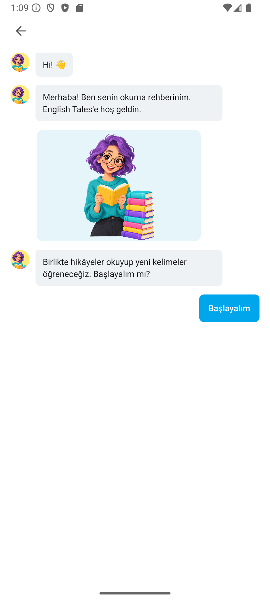
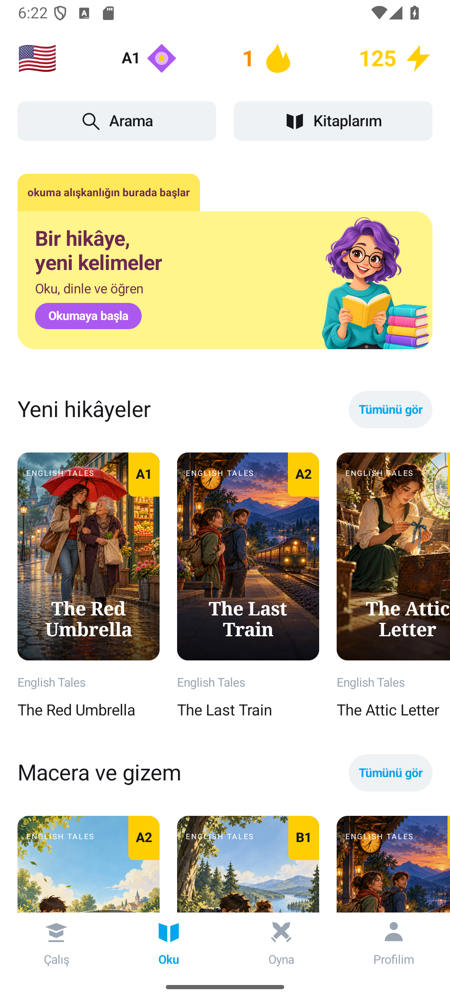
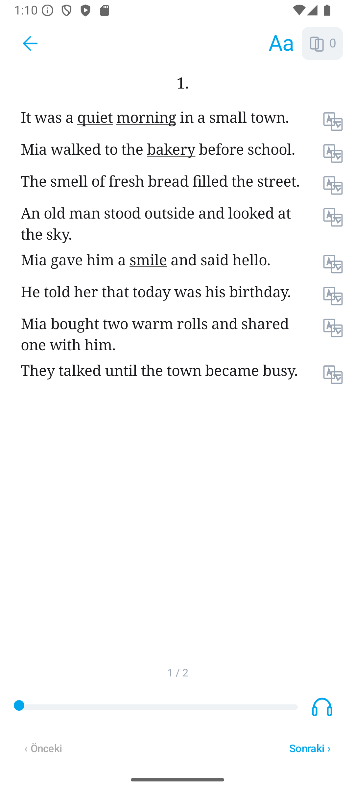

# English Tales Android

Kotlin ve Jetpack Compose ile hazırlanan yerel Android uygulamasının ilk çalışan sürümü. Eski React Native uygulaması projenin kökünde duruyor; bu klasör bağımsız bir Android Studio projesidir.

Ekran görüntülerinden çıkarılan deneyim için [ürün taslağına](PRODUCT_SPEC.md), [ekran referanslarına](UI_REFERENCE.md), [içerik kararına](CONTENT_GUIDE.md) ve yayın öncesi işler için [mimari notlarına](ARCHITECTURE.md) bakın.

## Çalışan akışlar

- Sohbet biçiminde seviye, hikâye türü ve günlük hedef seçimi; ilk hikâyeye doğrudan geçiş
- Hikâye kataloğu, arama, tür filtresi ve okuma ilerlemesi
- Sayfalı okuyucu, cümle çevirisi, kelime kartı ve cihazın metin okuma motoruyla seslendirme
- Üç aşamalı kelime defteri; kart, çeviri, eşleştirme ve kelime oluşturma alıştırmaları
- Kişisel günlük plan, zamanı gelen kelime tekrarları, haftalık etkinlik, puan ve gerçek çalışma serisi
- Okuma sonrası hikâyenin kelimelerine geçiş; başarılar, düzenlenebilir öğrenme ayarları ve isteğe bağlı günlük hatırlatıcı
- Room üzerinden çevrimdışı kayıt; sürüm/cümleyle okuma konumu ve değişmez işlem kuyruğu
- Tamamlanan çalışmalarda tür, soru sayısı ve ön plandaki aktif süre kaydı
- Mevcut hesapla giriş/çıkış, şifreli oturum saklama ve hesap başına ayrı yerel öğrenme verisi
- İlk açılışta misafir/Google/e-posta seçimi; native Google hesap seçicisi ve Supabase ID token bağlantısı
- Hesap ekranından tek seferlik yerel misafir aktarımı; kesinti sonrası devam ve tekrar puan koruması

Altı hikâye ve 39 kelime bu prototip için özgün olarak yazılmış örnek içeriktir. EWA ekranlarındaki metinler veya görseller kullanılmadı.

[İlk açılış ve düzenli öğrenme planı](docs/LEARNING_JOURNEY.md) · [Günlük plan ekranı](docs/preview-daily-plan.png) · [Okuma sonrası akış](docs/preview-reading-result.png)

## Emülatör görüntüleri

| Başlangıç | Kitaplık | Okuyucu |
| --- | --- | --- |
|  |  |  |

Diğer ekranlar: [Katalog](docs/preview-catalog.png) · [Hikâye](docs/preview-detail.png) · [Alıştırmalar](docs/preview-practice.png) · [Profil](docs/preview-profile.png) · [Kelime kutusu](docs/preview-word-popup.png) · [Kelimeler](docs/preview-words.png).

[Güncel kitaplık ve okuyucu](docs/content-update-overview.jpg) · [Referansla yan yana karşılaştırma](docs/reference-comparison.jpg) · [Dört alıştırma ekranı](docs/practice-overview.jpg) · [Kontrol sonuçları](docs/VERIFICATION.md) · [Rehber görselinin üretim kaydı](docs/ASSET_NOTES.md) · [Yeni kapaklar ve üretim istemleri](docs/NEW_COVER_ASSETS.md)

## Derleme

Android Studio'da `native-android` klasörünü açın. JDK 17 ve Android SDK 36 gerekir. Komut satırında:

```powershell
.\gradlew.bat :app:assembleDebug :app:testDebugUnitTest :app:lintDebug
```

Hata ayıklama APK'sı `app/build/outputs/apk/debug/app-debug.apk` konumunda oluşur. Uygulama kimliği yayınlanmış uygulamayla aynıdır: `com.yurken.englishtales`. Farklı imzalı eski bir geliştirme sürümü aynı cihazdaysa önce o sürüm kaldırılmalıdır; bu işlem yerel verilerini siler.

Cihaz/emülatör bağlıyken kalıcı kayıt kontrolleri: `.\gradlew.bat :app:connectedDebugAndroidTest`. 11 birim testi ve 45 cihaz testi bulunur: 15 öğrenme/veritabanı, 6 uzak içerik/önbellek, 13 oturum/hesap/Google ve 11 misafir aktarımı. İçerik testlerinden biri yapılandırılmış test projesini gerçek ağ üzerinden okur. Hesap testleri kontrollü Auth yanıtları kullanır; kişisel hesapla canlı e-posta girişi ve yeniden açılış kontrolü ayrıca doğrulandı. Entegrasyon testleri ayrı veritabanı ve tercihler kullanır; Gradle test görevi uygulamayı emülatöre kurup kaldırabilir. Gerçek oturum varken son kontrol, uygulamayı kaldırmadan APK'ları güncelleme ve instrumentation çalıştırma yoluyla yapıldı; Keystore korundu.

## Mimari ve sonraki işler

Mağaza yayını için öncelikler, aşamalar ve tamamlanma ölçütleri: [Google Play yayın yol haritası](docs/STORE_RELEASE_ROADMAP.md).

- `assets/catalog/v1.json`: Sürümlü, paket içi örnek katalog. `LearningContent.kt` dosyayı açılışta doğrular ve okur. İlk açılış için paket içi içerik korunur. Android canlı test kataloğuna bağlı; seçilen metin/kelime/kapak indirilir, doğrulanır ve çevrimdışı saklanır. [Bağlantı analizi ve sonuçları](docs/REMOTE_CONTENT_PLAN.md).
- `data/LearningStore.kt` / `LearningDatabase.kt`: Room v5 üzerinden ilerleme, tercihler, oturumlar ve kalıcı işlem kuyruğu. Eski native veriler korunur. Misafir ve her hesap için ayrı veritabanı açılır.
- `data/GuestTransfer.kt`: Açıkça seçilen hesaba yerel misafir aktarımı; kalıcı günlük ve makbuzla kesinti/tekrar koruması. Eski ölçülmemiş toplamlar ayrıca saklanır. Canlı öğrenme gönderimi ve cihazlar arası eşitleme henüz bağlı değildir. [Analiz ve doğrulama](docs/GUEST_TRANSFER_PLAN.md).
- `data/AccountSession.kt`: Mevcut hesapla giriş, sunucudan kullanıcı doğrulama, Keystore AES-GCM ile kalıcı oturum, token yenileme ve çıkış. Hesap değişince ekranlar yeniden kurulur; eski ekran eylemleri yeni hesaba uygulanmaz. [Analiz ve kalan aşamalar](docs/ACCOUNT_SYNC_PLAN.md) · [Giriş ekranı](docs/preview-account-login.png).
- `data/GoogleIdentity.kt` / `ui/WelcomeScreen.kt`: Hesap açmadan yerel misafir kullanımı; Credential Manager ile Google girişi. Test projesinde Google sağlayıcı ve debug Android imzası kayıtlı. Gerçek Google girişi, sunucudan oturum doğrulama ve kapatıp açınca aynı hesap/profilin korunması doğrulandı. `supabase.properties.example` içindeki genel ayarları yerel `supabase.properties` dosyasına yazın. Google secret Android'e girmez. [Karar ve doğrulama](docs/GUEST_GOOGLE_PLAN.md) · [Yeni başlangıç](docs/preview-welcome-guest-google.png).
- `backend/`: Supabase Database/Storage/Auth veri modeli ve işlem uçları. **English Tales test projesi bağlı; 6 hikâye yayınlandı. 27 SQL + 8 istemci testi geçti.** Android anonim içerik indirmesi ve mevcut hesapla giriş bağlı. Yerel misafir aktarımı hazır; öğrenme eşitlemesi ve hesap yaşam döngüsü sonraki aşamalardır. [Kurulum ve aşama durumu](backend/README.md) · [Eşitleme sözleşmesi](backend/SYNC_CONTRACT.md).
- `backend/admin/`: Hikâye, çeviri, kelime, kapak/ses, telefon önizlemesi ve yayın/arşiv paneli. `backend` içinde `npm run admin` ile açılır. [Panel kullanımı](backend/admin/README.md) · [Aşama analizi](docs/CONTENT_ADMIN_PLAN.md).
- `ui/`: Compose ekranları. Mevcut emülatörde akış çalışıyor; farklı boyutlarda ve gerçek cihazda erişilebilirlik, ses ve performans denemeleri yapılmalı.
- Yayın öncesinde içerik hacmi, çizimler/kapaklar, ses kalitesi, tekrar algoritması, gizlilik metni ve mağaza materyalleri tamamlanmalı.

Play Store'a güncelleme göndermeden önce Play Console'daki en yüksek `versionCode` ve orijinal yükleme anahtarı doğrulanmalıdır. Buradaki `versionCode = 4` geçicidir. Hata ayıklama APK'sı mağaza sürümü değildir; sürüm imzası yapılandırılmadı. Eski React Native verisi için taşıma kodu eklenmedi; native SQLite 1/2/3/4 → Room 5 geçişi mevcut native ilerlemeyi korur. Mevcut paket kimliği korundu.

[Çevrimdışı veri geçişi ve kontrol sonuçları](docs/OFFLINE_DATA_PLAN.md) · [Kapatıp açınca devam eden okuyucu](docs/preview-reader-resume.png)
