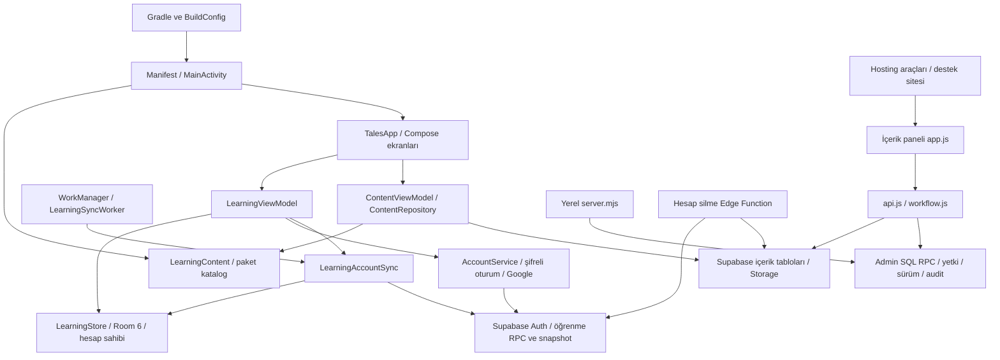

# English Tales — kaynak, bağımlılık ve değişiklik etki haritası

> Başlangıç incelemesi: 13 Ekim 2026, native `357abed`. Satır numaraları bu snapshot içindir. GitHub geçişi sonrası güncel kaynak ve doğrulama durumu için [geçiş kaydı](NATIVE_MIGRATION.md) ve [ürün planı](PRODUCT_ROADMAP.md). Aşağıdaki inceleme sırasında test çalıştırılmadığına ilişkin ifadeler tarihsel inceleme kapsamını belirtir; yeni test sonuçları geçiş PR'ında kayıtlıdır.

**Onay bekleyen harita. Kod düzenlemelerine geçilmedi.**

- İnceleme tarihi: 13 Ekim 2026.
- Depo: `/Users/oguzyurken/Code/english-tales`.
- Dal: `codex/native-release-preparation`.
- Kaynak noktası: `357abedb68c7194aab6b6f652fd5bfc2fe2d8598`.
- Git tarafından izlenen 243 dosya; ana Android kaynaklarında 36 Kotlin dosyası; 8 SQL migration; 13 cihaz testi dosyası, 2 JVM testi dosyası, 3 backend testi dosyası.
- Bu isteğin ardından kaynak okuma, Git durumu ve metin/referans taraması yapıldı. Yeni build/test, emülatör etkileşimi, ağ isteği, migration veya dağıtım yapılmadı. Bu rapor depo dışında oluşturuldu.
- Kapsam mevcut dalın çalışma kaynakları, testleri, kaynak varlıkları, yapılandırması, araçları ve dokümantasyon sınırlarıdır. Eski Expo kodu Git geçmişinde kalır; üçüncü taraf kütüphanelerin iç kaynakları ve canlı hizmet yapılandırması bu statik haritanın kapsamına girmez.

## Kanıt anahtarı

**K — Kaynak kanıtı:** Bağlantı verilen satırda görülen davranış veya tanımlanmış çağrı.

**E — Etki çıkarımı:** Kaynakta görülen sözleşme değişirse oluşabilecek sonuç. Bu bir arıza simülasyonu veya çalıştırılmış regresyon testi değildir.

**B — Belirsiz:** Statik kaynak veya referans taramasıyla kesinleştirilemeyen davranış; canlı ortam, cihaz, bağımlılık içi veya test yürütmesi gerekir.

Test bulunması, testin şu anda geçtiği anlamına gelmez. Dokümandaki tarihsel doğrulama kayıtları güncel çalışma kanıtı olarak kullanılmadı.

## 1. Sistem sınırları ve ana bağımlılık grafiği

Grafik uygulama kodunda görülen çağrıları özetler. Supabase ve Android framework içindeki yürütmenin tamamını temsil etmez.

**Aktif derleme:** [settings.gradle.kts:17](../settings.gradle.kts) yalnızca `:app` projesini içerir. Android araç zinciri [build.gradle.kts:1](../build.gradle.kts), Gradle dağıtımı [wrapper:3](../gradle/wrapper/gradle-wrapper.properties) ile belirlenir. Bu dalın aktif derlemesinde Expo/Firebase/Sanity giriş noktası bulunmadı.

## 2. Oturumdaki çalıştırma görevinin eriştiği alanlar

Henüz yeni bir özellik veya düzeltme tanımlanmadı. Bu nedenle gelecekte düzenlenecek dosyalar kesinleştirilemez. Mevcut görev, native dalı derlemek ve uygulamayı açmaktı. Aşağıdaki erişim alanları bu görev için kaynakta kanıtlandı:

| Tetikleyici | Erişilen kod / veri | Yan etki ve bağımlı parçalar |
|---|---|---|
| Debug derlemesi | Gradle dosyaları, manifest, bütün `src/main`, kaynak görselleri, katalog, yerel `supabase.properties` | BuildConfig, Room/KSP üretimi, APK ve derleme önbellekleri oluşur. Kaynaklar ve alan adları pakete girer. |
| Uygulamanın açılması | MainActivity → LearningContent → TalesApp → LearningViewModel ve ContentViewModel | Yerel veritabanı açılır/migrate edilir; kurulum kimliği oluşturulabilir; oturum okunur; ziyaret kaydı yazılır; içerik önbelleği yüklenir/temizlenir; katalog yenilenir. |
| Ön plana gelme | TalesApp yaşam döngüsü gözlemcisi | Ziyaret, oturum doğrulama, hatırlatıcı planlama ve katalog yenilemesi tetiklenir. |
| Daha önce giriş yapılmış hesapla açılış | AccountService, hesap Room dosyası, LearningAccountSync, Worker | Token yenilenebilir; öğrenme olayları/tercihler sunucuya gönderilebilir; snapshot yerel kayıtlara uygulanabilir. |
| Misafir başlangıç ekranı | WelcomeScreen | Düğmeye basılmadan misafir aktarımı, kayıt oluşturma, hesap silme veya öğrenme oturumu tamamlama çağrılmaz. |

Kanıt: [MainActivity:17](../app/src/main/java/com/yurken/englishtales/MainActivity.kt), [TalesApp:24](../app/src/main/java/com/yurken/englishtales/ui/TalesApp.kt), [LearningViewModel:31](../app/src/main/java/com/yurken/englishtales/data/LearningViewModel.kt), [RemoteContent:230](../app/src/main/java/com/yurken/englishtales/data/RemoteContent.kt).

## 3. Android kaynaklarının tamamı

Her satırdaki dosyalar aynı etki alanına ait olsa da ayrı kaynak dosyalarıdır. Son sütun **E** sınıfındadır: belirtilen sözleşmenin uyumsuz değiştirilmesi halinde beklenen etki.

| Kaynak / kanıt | Girdi ve bağımlılık | Ona bağımlı olanlar / uyumsuz değişikliğin etkisi |
|---|---|---|
| [MainActivity.kt:17](../app/src/main/java/com/yurken/englishtales/MainActivity.kt) | Android lifecycle, paket katalog, tema, bildirim intent'i | Bütün uygulama açılışı; `daily_plan_request` değişirse bildirimden günlük plana yönlendirme. |
| [TalesApp.kt:18](../app/src/main/java/com/yurken/englishtales/ui/TalesApp.kt) | LearningViewModel, ContentViewModel, account.scope, NavHost | Welcome/onboarding/main/story/reader/result/settings/downloads/account/words rotaları; hesap değişiminde UI durumu, okuma sürümü sabitleme ve session callback'leri. |
| [LearningViewModel.kt:13](../app/src/main/java/com/yurken/englishtales/data/LearningViewModel.kt) | Auth, storeFactory, actor kuyruğu, scope/syncEpoch, cloud sync | Ekranların tüm kalıcı işlemleri; scope koruması değişirse eski ekran veya geciken ağ yanıtı yeni hesaba uygulanabilir. İptal/generation davranışı hesap ve arka plan eşitlemesini birlikte etkiler. |
| [LearningStore.kt:30](../app/src/main/java/com/yurken/englishtales/data/LearningStore.kt) | Room, LearningContent, LearningPolicy, LearningOperations | Snapshot, puan/seri/rozet, kelime kaydı, okuma konumu, oturum, outbox; transaction sınırı değişirse yerel ödül ve gönderim kaydı ayrılabilir. |
| [LearningDatabase.kt:97](../app/src/main/java/com/yurken/englishtales/data/LearningDatabase.kt) | Guest/account sahipliği, Room 6, migration 1–3→4→5→6 | Store, transfer, reconciliation, temizleme ve testler. Dosya adı/owner/schema/SQL sütun değişikliği eski yerel veriye ve hesap ayrımına dokunur. |
| [LearningContent.kt:42](../app/src/main/java/com/yurken/englishtales/data/LearningContent.kt) | `catalog/v1.json`, indirilen/güncel/sabitlenmiş/eski sürümler | Bütün katalog/okuyucu/alıştırma ekranları, kelime ID çözümü, olaylara revision bulma. Global katalog ve eski kelime arşivi ortak bağımlılıktır. |
| [LearningOperations.kt:13](../app/src/main/java/com/yurken/englishtales/data/LearningOperations.kt) | SHA256 tabanlı sabit revision ID, kurulum ID, UTC zamanı ve cihaz saat dilimi | Exporter, outbox, üç öğrenme RPC'si; ID algoritması veya JSON alanları değişirse mevcut olaylar/revision referansları uyumsuzlaşır. |
| [LearningPolicy.kt:12](../app/src/main/java/com/yurken/englishtales/data/LearningPolicy.kt) | Gün anahtarı, seri hesabı, 1/3/7/14/30 günlük tekrar | Store ve günlük plan; sunucudaki `apply_word_event` tekrar kurallarıyla birlikte ele alınmalı. |
| [ForegroundLearningClock.kt:4](../app/src/main/java/com/yurken/englishtales/data/ForegroundLearningClock.kt), [ActiveLearningTime.kt:14](../app/src/main/java/com/yurken/englishtales/ui/ActiveLearningTime.kt) | Monotonik saat, lifecycle ve beş saniyelik checkpoint | Reader ve bütün oyunlar; ölçülen süre, session_drafts ve `activeSeconds` doğrulaması. Pause/dispose değişirse arka plan süresi puan kaydına karışabilir. |
| [AccountSession.kt:35](../app/src/main/java/com/yurken/englishtales/data/AccountSession.kt) | Auth HTTP, `/user` doğrulaması, AES-GCM/Keystore/AtomicFile | LearningViewModel, sync, worker; token yenileme, sahiplik, kayıt/kurtarma ve silme. Servis URL'si şifreli oturum namespace ve AAD'sinin parçasıdır. |
| [GoogleIdentity.kt:21](../app/src/main/java/com/yurken/englishtales/data/GoogleIdentity.kt) | Credential Manager, web OAuth ID, raw/hashed nonce | TalesApp → signInGoogle → Supabase token exchange. Nonce biçimi veya client ID değişikliği oturum açmayı etkiler. Android sertifika kaydı dış bağımlılıktır. |
| [DeletedAccountCleanup.kt:6](../app/src/main/java/com/yurken/englishtales/data/DeletedAccountCleanup.kt) | Sunucunun onayladığı owner makbuzu, guest transfer kayıtları | Açılışta ertelenmiş temizlik ve deleteAccount; owner filtreleri değişirse yanlış yerel DB silinebilir. |
| [GuestTransfer.kt:19](../app/src/main/java/com/yurken/englishtales/data/GuestTransfer.kt) | Misafir DB capture/claim, hedef import, hash/makbuz | AccountScreen ve VM; claim sonrası misafir alanı sıfırlanır, hedefe atomik import ve kaynak acknowledge gerekir. Puan/kelime tombstone önceliği reconciliation ile bağlıdır. |
| [LearningSync.kt:18](../app/src/main/java/com/yurken/englishtales/data/LearningSync.kt) | RPC allowlist, Auth token, immutable olay JSON, güvenli hata kodu | QueueSync → üç olay RPC'si; `applied` acknowledgement, retry/backoff ve blocked sınıflandırması. HTTP/SQL hata sözleşmesi değişirse olaylar tutulabilir veya hatalı onaylanabilir. |
| [LearningAccountSync.kt:36](../app/src/main/java/com/yurken/englishtales/data/LearningAccountSync.kt) | Önce snapshot, tercihler, bir olay/tur, sonra snapshot | VM ve worker; gönderim/alım sırası ve yerel ödülün iki kez sayılmaması. |
| [LearningCloudSnapshot.kt:46](../app/src/main/java/com/yurken/englishtales/data/LearningCloudSnapshot.kt) | Strict alan/tür/owner/tarih/UUID/sayı/limit doğrulaması | SnapshotReader, PreferencesSync ve Reconciliation; SQL snapshot şemasıyla eşzamanlı değişmeli. Geçersiz veri bütünüyle reddedilir. |
| [LearningReconciliation.kt:23](../app/src/main/java/com/yurken/englishtales/data/LearningReconciliation.kt) | Cloud snapshot, local outbox/drafts, baseline, source URL | Store projection, puan/gün/seri, pending kelime ve konum koruması, guest import sonrası rebase. Yanlış birleştirme veri kaybı veya çift toplam riski taşır. |
| [LearningPreferencesSync.kt:17](../app/src/main/java/com/yurken/englishtales/data/LearningPreferencesSync.kt) | Dirty alanlar, expected version, timezone, exact-field acknowledgement | AccountScreen çatışma seçimi, save_learning_preferences, cloud_state; eski yanıt yeni yerel tercihi temizlememeli. |
| [LearningSyncRuntime.kt:20](../app/src/main/java/com/yurken/englishtales/data/LearningSyncRuntime.kt) | Process singleton Auth, owner Mutex, generation, WorkManager | UI sync ve worker ortak hesap erişimi; tek seferlik/15 dakikalık işler, ağ koşulu, iptal etiketleri. Kotlin'de doğrudan çağrı olmasa da Worker framework tarafından çalıştırılır. |
| [RemoteContent.kt:101](../app/src/main/java/com/yurken/englishtales/data/RemoteContent.kt) | Anonim içerik HTTP, metadata, kapak hash/boyutu, dosya önbelleği | LearningContent.install, katalog/detail/downloads/reader; tablo alanları, sürüm ID, cover path/size/hash ve cache biçimi sözleşmedir. |
| [WelcomeScreen.kt:36](../app/src/main/java/com/yurken/englishtales/ui/WelcomeScreen.kt), [OnboardingScreen.kt:22](../app/src/main/java/com/yurken/englishtales/ui/OnboardingScreen.kt) | AccountState, Google/guest/email callback, level/genre/goal | TalesApp başlangıç rotası, store.completeOnboarding ve ilk hikâye önerisi. |
| [AccountScreen.kt:17](../app/src/main/java/com/yurken/englishtales/ui/AccountScreen.kt) | AccountState ve giriş/OTP/kurtarma/sync/transfer/silme callback'leri | VM hesap eylemleri; parola/kod remember ile tutulur, kalıcı saveable değildir. Transfer/çıkış/silme ayrı onay dialog'larıdır. |
| [CatalogScreens.kt:70](../app/src/main/java/com/yurken/englishtales/ui/CatalogScreens.kt) | LearningContent + LearningSnapshot + navigasyon callback | Study, Catalog, StoryDetail, Profile, SavedWords, ortak başlıklar. ID/level/genre ve progressFor değişimi arama, raf, tamamlanan sayısı ve devam akışını etkiler. Paylaşım Android intent başlatır. |
| [LearningJourney.kt:21](../app/src/main/java/com/yurken/englishtales/ui/LearningJourney.kt) | Snapshot, önerilen/kalmış hikâye, due words | DailyPlan, WeeklyActivity, EarnedBadges, ReadingResult, Settings; goal/stage/badge kimlikleri Store ve SQL ile ortak. |
| [ReaderScreen.kt:94](../app/src/main/java/com/yurken/englishtales/ui/ReaderScreen.kt) | Story revision/cümle/kelime, snapshot cursor, Narrator, timer | Progress, kelime toggle, reading complete, session checkpoint. Sekiz cümle/sayfa ve stable sentence ID devam konumunu belirler. |
| [PracticeScreen.kt:20](../app/src/main/java/com/yurken/englishtales/ui/PracticeScreen.kt), [FlashcardGame.kt:21](../app/src/main/java/com/yurken/englishtales/ui/FlashcardGame.kt), [MatchingGame.kt:19](../app/src/main/java/com/yurken/englishtales/ui/MatchingGame.kt) | Saved/due/global kelimeler, session UUID, dört oyun modu | Review + lesson completion + aktif süre + points; mod isimleri ve soru/cevap sınırları Store ve SQL ile ortak. Flashcard ayrıca TTS kullanır. |
| [ContentDownload.kt:14](../app/src/main/java/com/yurken/englishtales/ui/ContentDownload.kt), [BookCover.kt:41](../app/src/main/java/com/yurken/englishtales/ui/BookCover.kt) | ContentViewModel, story coverKey/coverFile, status | İndir/kaldır/yenile/retry ve dosyadan kapak render etme; dosya kaldırmak metin arşivini veya öğrenme geçmişini kaldırmaz. |
| [LearningReminders.kt:26](../app/src/main/java/com/yurken/englishtales/ui/LearningReminders.kt) | SharedPreferences, bildirim izni, AlarmManager, BroadcastReceiver | Günlük alarm, notification channel/icon, MainActivity intent. Hatırlatıcı ayarları hesap DB'sinden ayrı ve cihaz genelidir. |
| [ReferenceComponents.kt:33](../app/src/main/java/com/yurken/englishtales/ui/ReferenceComponents.kt), [Theme.kt:56](../app/src/main/java/com/yurken/englishtales/ui/Theme.kt) | Canvas ikonları, renkler, typography, büyük yazı yerleşimi | Bütün Compose ekranları; ortak UI değişimi gezinme, erişilebilirlik semantiği ve ekran boyutu davranışını etkiler. |
| [SupportLinks.kt:12](../app/src/main/java/com/yurken/englishtales/ui/SupportLinks.kt) | Sabit HTTPS/mailto URL'leri, LocalUriHandler | Account ve Settings yardım bağlantıları; hosting rewrite/domain ve destek sitesiyle birlikte değişmeli. |

### Android kalıcılık sözleşmesi

- Guest DB: `english_tales.db`; hesap DB: `english_tales_account_<UUID>.db`. Owner doğrulaması her DB açılışında çalışır. [LearningDatabase:97,146](../app/src/main/java/com/yurken/englishtales/data/LearningDatabase.kt)
- Room 6 tabloları: `saved_words`, `story_progress`, `learning_stats`, `learning_days`, `engagement_events`, `earned_badges`, `local_profile`, `local_identity`, `learning_outbox`, `session_drafts`, `guest_transfers`, `guest_imports`, `learning_cloud_state`. Entity tanımları: [LearningDatabase:11](../app/src/main/java/com/yurken/englishtales/data/LearningDatabase.kt).
- Schema 4/5/6 JSON'ları geçmiş şemadır; mevcut modelle birlikte migration uyumluluğunun girdileridir. Ölü/gereksiz dosya olarak değerlendirilmedi. Migration kaynakları: [LearningDatabase:116](../app/src/main/java/com/yurken/englishtales/data/LearningDatabase.kt).
- Paket katalog şeması 1; dosyada 6 hikâye, 39 kelime, 81 cümle var. Bu sayılar JSON'dan okundu; canlı katalog sayısı olarak yorumlanmadı. [Katalog](../app/src/main/assets/catalog/v1.json)
- Kelime kimlikleri ve öğrenme durumları revizyonlar arasında korunurken okuma konumu revision + sentence ID ile bağlıdır. Yerel yüzde, revision değişince yeniden değerlendirilir. [progressFor:34](../app/src/main/java/com/yurken/englishtales/data/LearningContent.kt)

## 4. Backend, panel ve web kaynaklarının tamamı

| Kaynak / kanıt | Bağımlılık ve çağıranlar | Değişiklik etki alanı — E |
|---|---|---|
| [admin/index.html:2](../backend/admin/index.html), [styles.css:1](../backend/admin/styles.css), favicon.svg | app.js DOM giriş noktası, CSS sınıfları ve breakpoint'ler | Panel DOM seçicileri, responsive editör/preview/dialog yerleşimi; hosting builder aynı dosyaları kopyalar. |
| [admin/app.js:1](../backend/admin/app.js) | api.js, workflow.js, DOM, localStorage, revision edit_version | Katalog, metin/kelime/medya editörü, yayın, arşiv, geçmiş ve taslak yedeği; veri şekli veya RPC isimleri değiştirilirse editör ve okuyucu önizlemesi etkilenir. |
| [admin/api.js:2](../backend/admin/api.js) | `/api/config`, Auth, admin RPC, Storage, SHA256 ve blob URL | app.js; demo/cloud ayrımı, oturum refresh generation, upload ve medya silme saga'sı. Token yalnızca bellekte tutulur. |
| [admin/workflow.js:1](../backend/admin/workflow.js) | Sözcük/ifade normalizasyonu, draft backup biçimi ve owner/project/revision key | Panel bağlantı doğrulaması ve recovery; SQL publication_word_links kontrolü ve mobil kelime çözümüyle ilişkili. |
| [admin/server.mjs:8](../backend/admin/server.mjs) | Env, Node HTTP, PGlite, migrations, fixture, seed ve manifest | Yerel panel: env yoksa kalıcı demo DB kurar; cloud varsa client config ve statik dosya sunar. Demo sonuçları canlı hizmet doğrulaması değildir. Host/origin/RPC allowlist ve medya imzası kontrolleri giriş sınırıdır. |
| [delete-account/index.ts:3](../backend/supabase/functions/delete-account/index.ts), [handler.js:2](../backend/supabase/functions/delete-account/handler.js) | Server-only service role, user Auth, recent-session RPC, media inventory/Storage | Android AccountService.deleteAccount; medya devri → global session revoke → Auth delete → acknowledgement. Hatalı sıralama paylaşılan medyayı veya hesabı etkiler. |
| [config.toml:3](../backend/supabase/config.toml) | Yerel API/DB/Storage/Auth, seed, functions.verify_jwt=false | Yerel Supabase ve Edge Function; handler kendi token/recent-session kontrolünü yaptığı için gateway ayarı tek başına güvenlik kanıtı değildir. |
| [confirmation.html:7](../backend/supabase/templates/confirmation.html), [recovery.html:7](../backend/supabase/templates/recovery.html) | Supabase `.Token`, doğrulama/kurtarma ekranı | OTP metni ve kullanıcı akışı; SMTP/konu/süre sağlayıcı ayarları depoda bütünüyle tanımlı değildir. |
| [web/index.html:1](../web/index.html), [privacy.html:1](../web/privacy.html), [delete-account.html:1](../web/delete-account.html), [web/styles.css:1](../web/styles.css) | Statik destek sitesi, Play paket adı, mailto, hosting rewrites | SupportLinks ve hesap/veri politikası. Web silme düğmesi mailto açar; doğrudan silme RPC'si çağırmaz. Politika metnindeki sağlayıcı/saklama iddiaları canlı ayar kanıtı değildir. |

### Sekiz migration ve sunucu veri sözleşmesi

| Migration | Tanımladığı alan | Kim bağımlı / değişiklik etkisi |
|---|---|---|
| [202610100001_content.sql:22](../backend/supabase/migrations/202610100001_content.sql) | `content_assets`, `stories`, `story_revisions`, `story_sentences`, `revision_words`, `sentence_words`; private staff; RLS; immutable trigger; publish/archive | Android ContentHttp/Codec, panel, Storage, seed/export/backup. Revision/sentence/word ID ve yayınlanmış sürümün değişmezliği ortak temeldir. |
| [202610100002_learning.sql:3](../backend/supabase/migrations/202610100002_learning.sql) | Yedi öğrenme tablosu; own-user RLS; preferences CAS; session/word/progress RPC; badge/summary | LearningOperations, QueueSync, Snapshot, Reconciliation, Policy. Hesap auth.uid üzerinden çıkarılır; payload owner göndermez. UUID + immutable payload tekrar korumasıdır. |
| [202610100003_content_admin.sql:2](../backend/supabase/migrations/202610100003_content_admin.sql) | edit_version ve child bump trigger; content_role/admin_catalog/revision/create/save/publish | Panel api.js/app.js ve demo server. Save bütün child satırlarını yeniden yazar; sürüm kontrolü ve transaction birlikte gerekir. |
| [202610100004_admin_completion.sql:2](../backend/supabase/migrations/202610100004_admin_completion.sql) | private audit; history/delete/archive; publication word-link kontrolü; media reservation/finalization ve policies | Panel geçmiş/temizlik; frozen içerik ve medya güvenliği. Child/medya güncellemesi başka revision sayacı veya audit kaydı da yaratabilir. |
| [20261011134638_learning_snapshot.sql:5](../backend/supabase/migrations/20261011134638_learning_snapshot.sql) | Stable, security invoker, tek snapshot; schemaVersion 1; 4 MiB ve satır limitleri | Android strict decoder. Tarih/alan/limit/boş profil sözleşmesi birlikte değişmeli; eksik snapshot silme gibi yorumlanmaz. |
| [20261011151750_restrict_platform_helpers.sql:3](../backend/supabase/migrations/20261011151750_restrict_platform_helpers.sql) | Staff RLS ve varsa rls_auto_enable yetki kapatma | API privilege sınırı ve güvenlik testleri. Dashboard yardımcı fonksiyonunun canlı varlığı ayrıca bilinmiyor. |
| [20261011153145_account_deletion_authorization.sql:3](../backend/supabase/migrations/20261011153145_account_deletion_authorization.sql) | Kullanıcının yaşayan, son 5 dakikada oluşmuş session doğrulaması | Edge Function gate; yeniden giriş gereksinimi session created_at'ına bağlıdır. |
| [20261011195136_account_media_deletion_inventory.sql:4](../backend/supabase/migrations/20261011195136_account_media_deletion_inventory.sql) | Yalnızca service_role için owned-media inventory | Delete handler'ın medya koruma aşaması; bilinmeyen dosya veya uyuşmayan hash silmeyi durdurur. |

**Mobil → sunucu sözleşmeleri:**

- `submit_learning_session`: session ID, installation ID, kind, revision, start/finish, activeSeconds, correctAnswers, questionCount, timezone. Beş oyun/okuma türü ve puan = doğru × 5. [LearningOperations:37](../app/src/main/java/com/yurken/englishtales/data/LearningOperations.kt), [SQL:174](../backend/supabase/migrations/202610100002_learning.sql).
- `apply_word_event`: save/remove/review; word ID ve yayımlanmış source revision; occurredAt ve timezone. Sonuç tekrar yürütülerek hesaplanır. [SQL:213](../backend/supabase/migrations/202610100002_learning.sql).
- `apply_progress_event`: revision + sentence + percent + occurredAt. En yüksek yüzde korunurken en son olay cursor'u belirler. [SQL:266](../backend/supabase/migrations/202610100002_learning.sql).
- `save_learning_preferences`: expected_version ve exact-field acknowledgement. [LearningPreferencesSync:34](../app/src/main/java/com/yurken/englishtales/data/LearningPreferencesSync.kt).
- `get_learning_snapshot`: profile, sessions, words/tombstones, progress/revisions, badges; owner, capturedAt ve schemaVersion zorunlu. Decoder session ≤10.000, word/progress ≤5.000, badge ≤5 ve body ≤4 MiB bekler. [LearningCloudSnapshot:46](../app/src/main/java/com/yurken/englishtales/data/LearningCloudSnapshot.kt).

## 5. Derleme, kaynak varlıkları, operasyon araçları

| Alan | Kanıt / bağlı parçalar | Değişiklik etkisi ve yan etki |
|---|---|---|
| Android BuildConfig ve imza | [app/build.gradle.kts:11](../app/build.gradle.kts) | Debug yerel supabase.properties; release config/production.properties ve signing.properties. Uygulama kimliği `com.yurken.englishtales`; 47/2.0.0; min24/target36; JDK17. Release kaynak daraltma/R8 kullanır. |
| Gradle plugin/dependency/wrapper | [app/build.gradle.kts:91](../app/build.gradle.kts), [build.gradle.kts:1](../build.gradle.kts) | Compose, Room/KSP, WorkManager, Credential Manager, Google ID, graphics-path, desugaring. Native ELF ve JSON/tarih behavior'u bağımlılık değişiminden etkilenebilir; bağımlılık iç kaynakları incelenmedi — B. |
| Manifest ve XML kaynaklar | [AndroidManifest.xml:10](../app/src/main/AndroidManifest.xml), [themes.xml:2](../app/src/main/res/values/themes.xml) | MainActivity/receiver system entry, allowBackup=false, bildirim/TTS izin sınırı, app_name, launcher/round/foreground mipmap ve iconBackground; kaldırmak açılış, sistem UI veya resource resolution'ı etkiler. |
| Görsel varlıklar | [BookCover:31](../app/src/main/java/com/yurken/englishtales/ui/BookCover.kt), [WelcomeScreen:29](../app/src/main/java/com/yurken/englishtales/ui/WelcomeScreen.kt), [LearningReminders:52](../app/src/main/java/com/yurken/englishtales/ui/LearningReminders.kt) | Altı bundled kapak, reading_guide, google_g, notification vector ve density/qualifier ikonları. Kapak bytes değişirse export manifest hash ve seed metadata da değişmelidir. Doküman ekran görüntüleri uygulama runtime girdisi değildir. |
| Katalog exporter | [export-catalog.mjs:4](../backend/tools/export-catalog.mjs) | Paket JSON + cover bytes → seed.sql + asset-upload-manifest.json. Üretilen seed taslak oluşturur, yayınlamaz. **Modül import etmek dahi top-level dosya yazımlarını çalıştırır** (44–45). Stable ID Android ile aynı algoritmadır. |
| Seed ve asset manifest | [seed.sql:1](../backend/supabase/seed.sql), [manifest:1](../backend/supabase/asset-upload-manifest.json) | Demo server, local Supabase, backend testleri, cover checksum ve draft içerik ilişkileri. Runtime learning verisini veya canlı Auth'u temsil etmez. |
| Depo denetimi | [verify_repository.py:8](../../tooling/verify_repository.py) | Git index'i okur; gizli/üretilmiş dosya, conflict marker ve belirli credential biçimlerini kontrol eder. Çalışma ağacındaki bütün olası sırları tespit ettiği kanıtlanmış değildir — B. |
| ELF/paket kontrolü | [elf_alignment.py:11](../../tooling/elf_alignment.py), [verify_native_package.py:8](../../tooling/verify_native_package.py), [verify_release.py:12](../../tooling/verify_release.py) | ARM64/x86_64 ELF64, ZIP align, imza ve release DEX servis URL kontrolü; release script ayrıca release-verification.json yazar. Static doğrulama Play split veya gerçek cihaz kanıtı değildir. |
| Native cihaz/probe | [NativePageSizeTest:11](../app/src/androidTest/java/com/yurken/englishtales/data/NativePageSizeTest.kt), [NativeAlignmentInstrumentation:15](../app/src/releaseProbe/java/com/yurken/englishtales/data/NativeAlignmentInstrumentation.kt) | graphics-path load ve isteğe bağlı/zorunlu 16 KiB kontrolü. releaseProbe özel Gradle property ile seçilir; doğrudan uygulama UI rotası değildir. |
| Hosting paketleyici | [build_hosting.py:14](../../tooling/build_hosting.py) | Support HTML/CSS ve admin client → build/hosting/public; /studio yollarını dönüştürür, config JSON/Firebase headers/rewrites üretir. Kendi generated hosting klasörünü önce siler. |
| Public içerik yedeği | [backup_public_content.mjs:8](../../tooling/backup_public_content.mjs) | Production public config, altı okuyucu görünür tablo + medya hash; build/content-backups'a dosya yazar ve canlı GET yapar. Auth/learning/draft/archive/audit tam yedeği değildir. |
| İçerik geri yükleme doğrulaması | [verify-content-restore.mjs:11](../backend/tools/verify-content-restore.mjs) | Public backup + migrations + test fixture → izole PGlite. Revision version trigger'ını geçici kapatıp açar; canlı restore yapmaz. |
| Android outbox sözleşme aracı | [verify-android-outbox.mjs:11](../backend/tools/verify-android-outbox.mjs) | Dışarı aktarılmış olay JSON'u → izole SQL RPC ve duplicate replay. Hosted Auth/JWT kontrolü değildir. |
| Hosted kontrol aracı | [verify-hosted.mjs:5](../backend/tools/verify-hosted.mjs) | Env ile seçilen canlı servise GET ve anonim RPC POST; katalog ve erişim reddi kontrolü. Salt yerel test değildir. |
| Panel HTTP doğrulaması | [verify-admin-http.mjs:11](../backend/tools/verify-admin-http.mjs) | Demo server süreçleri başlatır; test-output içinde DB/medya, publish/archive/delete işlemleri yaratır; persistence kontrolü için yeniden başlatır. |
| CI | [verify.yml:19](../../.github/workflows/verify.yml) | Repo/ELF test; npm backend + panel HTTP test; Android debug + androidTest APK + unit test + lint + ELF paket kontrolü. Cihaz instrumentation testlerini **çalıştıran görev yok** (51). |

Yerel `.properties`, imza anahtarları, `.env.admin`, generated build dosyaları Git kapsamı dışındadır. Bu Mac'te local.properties ve supabase.properties mevcut, signing.properties yok. [Release guard:26](../app/build.gradle.kts) nedeniyle imza ayarı olmadan release görevi durur. Gizli ayar değerleri rapora alınmadı.

## 6. Gizli / dolaylı yan etkiler ve riskler

1. **K — Açılış/ön plana geliş yazma ve ağ işi üretir.** VM restore + recordVisit; `ON_RESUME` refresh/verify/reminder/content refresh; ContentVM init restore→refresh. Sadece ekranı açarak kayıt veya ağ işlemi oluşabilir. [VM:40](../app/src/main/java/com/yurken/englishtales/data/LearningViewModel.kt), [TalesApp:38](../app/src/main/java/com/yurken/englishtales/ui/TalesApp.kt).
2. **K — Genel mutate yolu sync planlar.** Kelime, ilerleme, ayar, checkpoint ve ziyaret gibi işlemler `mutate` sonrasında `scheduleSync` çağırır; hesap varsa tek seferlik ve periyodik Worker yaratır. [VM:100](../app/src/main/java/com/yurken/englishtales/data/LearningViewModel.kt), [Runtime:38](../app/src/main/java/com/yurken/englishtales/data/LearningSyncRuntime.kt).
3. **K — Session okuması bozuk dosyayı siler.** Şifreli storage.read herhangi bir Exception'da AtomicFile.delete ve null yapar. Read adı yan etkisiz olduğu anlamına gelmez. [AccountSession:75](../app/src/main/java/com/yurken/englishtales/data/AccountSession.kt).
4. **K — Guest claim kaynak geçmişini boşaltır.** Önce pending journal kaydedilir; sonra profile dışındaki capture tabloları silinir. Import/acknowledge/makbuz birlikte korunmalı. [GuestTransfer:54](../app/src/main/java/com/yurken/englishtales/data/GuestTransfer.kt).
5. **K — İçerik restore kapak dosyası silebilir; download kaldırma metni bırakır.** Restore doğrulanamayan/indirilen olarak tanınmayan `.cover` dosyalarını temizler; removeDownload metin arşivini saklar. [RemoteContent:135](../app/src/main/java/com/yurken/englishtales/data/RemoteContent.kt), [RemoteContent:211](../app/src/main/java/com/yurken/englishtales/data/RemoteContent.kt).
6. **K — SQL child/medya değişiklikleri ek kayıt üretir.** Cümle/kelime/link mutasyonları parent edit_version artırır; medya değişimi bağlı taslakların sayacını artırır; revision/archive audit trigger'ları işlem geçmişi yazar. [admin migration:9](../backend/supabase/migrations/202610100003_content_admin.sql), [completion:120](../backend/supabase/migrations/202610100004_admin_completion.sql).
7. **K — get_learning_summary salt okuma değildir.** `private.lock_learning_user` profile INSERT ve FOR UPDATE yapar; adı summary olsa da yazma yan etkisi vardır. Yeni snapshot RPC'si ise profile oluşturmaz. [learning.sql:113](../backend/supabase/migrations/202610100002_learning.sql), [learning.sql:296](../backend/supabase/migrations/202610100002_learning.sql).
8. **K/E — Hatırlatıcı aktif hesabın hedefini okumuyor.** Receiver `LearningStore(context)` açar; Store default owner Guest'tir. **Etki çıkarımı:** hesapla hedef tamamlanmış olsa da misafir hedefine göre bildirim kararı verilebilir. Cihaz senaryosu çalıştırılmadı. [Receiver:63](../app/src/main/java/com/yurken/englishtales/ui/LearningReminders.kt), [Store:30](../app/src/main/java/com/yurken/englishtales/data/LearningStore.kt).
9. **K/E — Çok sözcüklü kelime sözleşmesi farklı.** Panel `occurs` ifadeleri kabul eder; Android TappableSentence tek token ile tam kelime arar. **Etki çıkarımı:** “picked up” gibi ifade panelde geçerli olup okuyucuda tek dokunulabilir kelime olarak bulunmayabilir. [workflow:1](../backend/admin/workflow.js), [ReaderScreen:195](../app/src/main/java/com/yurken/englishtales/ui/ReaderScreen.kt), [panel testi:55](../backend/tests/admin-client.test.mjs).
10. **K — Panel sesi mevcut mobil okuyucuya bağlanmıyor.** Admin audio upload/preview ve SQL audio_asset_id içerir; Android Story modeli audio alanı taşımaz, ContentRepository yalnızca kapak indirir, Narrator cihaz TTS'si kullanır. Bu backend özelliğinin ölü olduğu anlamına gelmez; mobil tüketimi eksik/ayrı bir yüzeydir. [Story:11](../app/src/main/java/com/yurken/englishtales/data/LearningContent.kt), [Reader Narrator:38](../app/src/main/java/com/yurken/englishtales/ui/ReaderScreen.kt), [panel:46](../backend/admin/app.js).
11. **K — Hesap silme Storage üzerinde de yazma yapar.** Delete handler önce medya byte/hash doğrular, service role ile PUT yapar, yeniden inventory kontrol eder, sonra bütün session'ları revoke ve Auth delete yapar. Salt tek DELETE değildir ve çok adımlı HTTP işlemi bir SQL transaction'ı değildir. [handler:36](../backend/supabase/functions/delete-account/handler.js).
12. **K/E — Bazı öğrenme hatalarının UI tüketimi dar.** Mutation Exception mesajı AccountState'e yazılır; Account/Welcome bu mesajı render eder, Reader/Practice bu state'i doğrudan almaz. **Etki çıkarımı:** okuma/oyun sırasında başarısız kalıcı işlem bu ekranlarda açık bir hata mesajı göstermeyebilir. Hata enjeksiyonu yapılmadı. [VM:53](../app/src/main/java/com/yurken/englishtales/data/LearningViewModel.kt), [AccountScreen:117](../app/src/main/java/com/yurken/englishtales/ui/AccountScreen.kt).

## 7. Ölü kod ve erişilebilirlik sınıflandırması

**Depo içi referans taramasında yalnızca tanımı bulunan adaylar:**

| Sembol | Kanıt | Sonuç |
|---|---|---|
| `SectionTitle` | [CatalogScreens:332](../app/src/main/java/com/yurken/englishtales/ui/CatalogScreens.kt) | Ana/test Kotlin kaynaklarında çağıran bulunmadı. Ölü kod adayı; silinmedi. |
| `TaleCream` | [Theme:23](../app/src/main/java/com/yurken/englishtales/ui/Theme.kt) | Okuyan kaynak referansı bulunmadı. Kullanılmayan renk sabiti adayı. |
| `TaleNavy` | [Theme:25](../app/src/main/java/com/yurken/englishtales/ui/Theme.kt) | Okuyan kaynak referansı bulunmadı. Kullanılmayan renk sabiti adayı. |
| `ReferenceIcon` içindeki `bookmark` dalı | [ReferenceComponents:52](../app/src/main/java/com/yurken/englishtales/ui/ReferenceComponents.kt) | Ana Kotlin kaynaklarında bu icon key için tüketici bulunmadı. **B:** string dispatch olduğundan kesin erişilemezlik hükmü verilmedi. |

**Ölü kod sayılmayanlar:**

- MainActivity lifecycle yöntemleri, Room Callback.onOpen, BroadcastReceiver.onReceive, TTS callback'leri, Worker ve releaseProbe: framework/manifest/Gradle girişleri var.
- `get_learning_summary`, `publish_story_revision`, `set_story_archived`: mobilde doğrudan kullanılmayanlar da backend RPC'leri, diğer RPC'ler, test/operasyon araçları tarafından tüketiliyor.
- `stableId` exporter: çağrılan bir fonksiyon; modülü top-level yazım içerdiği için testler import etmek yerine kendi algoritmasını tanımlamış. Bunun nedeninin bilerek yan etkiden kaçınma olduğu **B**; yalnızca iki bağımsız tanımın varlığı kanıtlı.
- Room geçmiş schema'ları, seed/manifest ve launcher qualifier varlıkları: migration, exporter, demo veya Android resource sistemi girdileri.
- Docs görselleri ve tarihsel yayın kayıtları: runtime kodu değil; kullanılmıyor diye silinebilir oldukları çıkarılmadı.
- Bağımlılık olarak bulunan graphics-path: cihaz testi ve releaseProbe açıkça loadLibrary çağırıyor; native paket doğrulaması bu binary'ye bağlı.

Bu tarama whole-program/R8 erişilebilirlik ispatı değildir. Yalnızca sözcük sayımı sonucu ölü kod kararı verilmedi.

## 8. Test bağımlılık haritası ve kanıt sınırı

Kaynakta **106 cihaz @Test yöntemi + 11 JVM @Test yöntemi + 50 backend test bildirimi** bulundu. Bunlar test tanım sayılarıdır; bu istekte çalıştırılan/geçen test sayısı **0**. Android test haritası yöntem bildirimleri ve sınıf referanslarıyla çıkarıldı; bütün test gövdelerinin bağımsız doğruluk denetimi yapıldığı iddia edilmiyor.

| Test dosyası | Tanım sayısı | Bağlı alan / kanıt |
|---|---:|---|
| [LearningStoreTest.kt:23](../app/src/androidTest/java/com/yurken/englishtales/data/LearningStoreTest.kt) | 15 | Kalıcılık, migration 1/2/3, cursor, immutable outbox, session/ödül ve hesap ayrımı. |
| [RemoteContentTest.kt:68](../app/src/androidTest/java/com/yurken/englishtales/data/RemoteContentTest.kt) | 6 | Pagination/cache/hash/download/remove/pin ve yapılandırılmış servise canlı GET. Son test ayar yoksa skip; gerçek network testidir (115–117). |
| [AccountSessionTest.kt:46](../app/src/androidTest/java/com/yurken/englishtales/data/AccountSessionTest.kt) | 9 | Keystore storage, Auth restore/refresh/signout, Google nonce/exchange. |
| [AccountLifecycleTest.kt:52](../app/src/androidTest/java/com/yurken/englishtales/data/AccountLifecycleTest.kt) | 7 | Signup/resend/OTP/recovery ve delete acknowledgement. |
| [AccountSwitchTest.kt:65](../app/src/androidTest/java/com/yurken/englishtales/data/AccountSwitchTest.kt) | 9 | VM owner değişimi, stale action, Google, silme ve in-flight sync. |
| [DeletedAccountCleanupTest.kt:14](../app/src/androidTest/java/com/yurken/englishtales/data/DeletedAccountCleanupTest.kt) | 1 | Yeniden açılış temizliğinin yalnızca onaylanmış owner'a uygulanması. |
| [GuestTransferTest.kt:50](../app/src/androidTest/java/com/yurken/englishtales/data/GuestTransferTest.kt) | 11 | Claim/import/replay/hash, tombstone önceliği ve legacy totals/migration4. |
| [LearningSyncTest.kt:40](../app/src/androidTest/java/com/yurken/englishtales/data/LearningSyncTest.kt) | 8 | Queue acknowledgement, retry, wrong owner, scope change ve HTTP decode. |
| [LearningCloudSnapshotTest.kt:36](../app/src/androidTest/java/com/yurken/englishtales/data/LearningCloudSnapshotTest.kt) | 7 | Strict schema/type/date/UUID/size/owner decode ve reader scope. |
| [LearningReconciliationTest.kt:57](../app/src/androidTest/java/com/yurken/englishtales/data/LearningReconciliationTest.kt) | 17 | Baseline, iki cihaz, tombstone, rollback, immutable history, migration5 ve guest rebase. |
| [LearningAccountSyncTest.kt:43](../app/src/androidTest/java/com/yurken/englishtales/data/LearningAccountSyncTest.kt) | 12 | Upload/pull sırası, lost acknowledgement, CAS conflict ve preferences seçimi. |
| [LearningSyncWorkerTest.kt:14](../app/src/androidTest/java/com/yurken/englishtales/data/LearningSyncWorkerTest.kt) | 3 | Wrong/missing owner ve network-constrained tek periyodik job; bütün gerçek arka plan senaryolarının kanıtı değildir. |
| [NativePageSizeTest.kt:11](../app/src/androidTest/java/com/yurken/englishtales/data/NativePageSizeTest.kt) | 1 | Native load; requiredPageSize argümanı yoksa belirli sayfa boyutu assert edilmez. |
| [ForegroundLearningClockTest.kt:7](../app/src/test/java/com/yurken/englishtales/data/ForegroundLearningClockTest.kt) | 3 | Monotonik aktif süre/restore ve bundled revision sabiti. |
| [LearningPolicyTest.kt:10](../app/src/test/java/com/yurken/englishtales/data/LearningPolicyTest.kt) | 8 | Seri/gün sınırı ve tekrar aralıkları. |
| [backend.test.mjs:45](../backend/tests/backend.test.mjs) | 33 | İzole PGlite + migrations/seed: RLS, yayın/değişmezlik, learning RPC, snapshot, admin, media ve cascade. |
| [admin-client.test.mjs:8](../backend/tests/admin-client.test.mjs) | 8 | Fake fetch ile refresh/session, upload/remove, phrase/link ve backup biçimi. |
| [account-deletion.test.mjs:7](../backend/tests/account-deletion.test.mjs) | 9 | Fake fetch ile gate/origin/confirm, media devri, revoke/delete sıralaması ve hata sınırları. |
| [test_elf_alignment.py:16](../../tooling/test_elf_alignment.py) | 6 | Sentetik ELF LOAD/RELRO hizalama regresyonları; cihaz çalıştırması değildir. |

Backend [platform-fixture.sql:1](../backend/tests/platform-fixture.sql) Auth/Storage/JWT imza ve hosted HTTP'yi emüle etmediğini açıkça belirtiyor. CI test APK'sını derler fakat `connectedDebugAndroidTest` çalıştırmaz. Bu nedenle CI yeşil olsa bile cihaz/Google/OTP/WorkManager davranışının geçtiği çıkarılamaz.

## 9. Kanıtlanmamış noktalar ve uyumsuz dokümantasyon

- **B:** Canlı Supabase'in bu sekiz migration ile aynı schema/policy/grant/function sürümünü kullandığı bu incelemede doğrulanmadı.
- **B:** Google Android client kaydında bu Mac'in debug sertifikasının mevcut olduğu; Play imzalı Google girişinin ve cihazdaki gerçek oturum restore'unun çalıştığı doğrulanmadı.
- **B:** SMTP, Brevo tracking/retention, OTP konu/süre ve rate limit ayarları kaynak dosyalarının varlığından doğrulanamaz.
- **B:** Support/Studio hosting'in üretilen dosyalarla aynı dağıtımı sunduğu; web linklerinin güncel HTTP yanıtları kontrol edilmedi.
- **B:** Gerçek cihaz TTS motoru, arka plan/Doze/izin davranışı, erişilebilirlik ve UI yarışları kaynak okumayla ispatlanmadı.
- **B:** Static ELF/imza kontrolleri fiziksel ARM64, Play split, mağaza dağıtımı veya eski sürüm verilerinin uçtan uca taşınma kanıtı değildir.
- **K:** Native README hâlâ eski React Native kodunun kökte durduğunu söylüyor ([README:3](../README.md)); mevcut dalın izlenen dosyaları ve settings.gradle bu anlatımla uyuşmuyor.
- **K:** Aynı README 45 cihaz testi diyor ([README:45](../README.md)); kaynakta 106 test bildirimi var. Docs tarihsel bilgi içeriyor.
- **K:** app/build.gradle.kts 46 kodunu geçmiş not olarak tutarken gerçek tanımı 47 ([Gradle:49](../app/build.gradle.kts)). Play'deki bugün en yüksek kodun ne olduğu bu incelemede kontrol edilmedi.
- **B:** Ölü kod adayları kaynak referans taramasıdır; reflection, framework veya dış tüketici için mutlak whole-program kanıtı değildir. Çerçeve callback'leri bu nedenle aday listesinden çıkarıldı.
- **B:** Henüz yapılacak yeni değişiklik tarif edilmedi. Onaylanan harita üzerinde belirli bir değişiklik seçildiğinde, o değişikliğin tam çağrı/sözleşme alanı bu kaynak noktasına göre ayrıca daraltılmalı.

## 10. Onay durumu

Harita hazır; manuel onay bekliyor. Kaynak, yapılandırma, test, SQL veya operasyon aracı düzenlenmedi. İnceleme sonunda tracked/staged Git diff boş.

Onay verilene kadar kod düzenleme, migration, bağımlılık yükseltmesi veya bu haritadaki adayları silme işlemi başlatılmayacak.

## Ek: 243 dosyanın tam envanteri

[Dosya envanteri — TSV](CODEBASE_INVENTORY.tsv) tüm izlenen dosyaları, kategoriyi, satır sayısını ve inceleme/kanıt sınırını listeler.

| Kategori | Dosya sayısı |
|---|---:|
| admin | 8 |
| android-resource | 29 |
| android-runtime | 36 |
| android-tests | 15 |
| backend-migration | 8 |
| backend-tests-fixture | 4 |
| build-config-repository | 21 |
| catalog-seed-manifest | 3 |
| documentation-reference | 95 |
| edge-function | 2 |
| operations-tool | 12 |
| public-web-mail-template | 6 |
| release-probe | 1 |
| room-history-schema | 3 |
