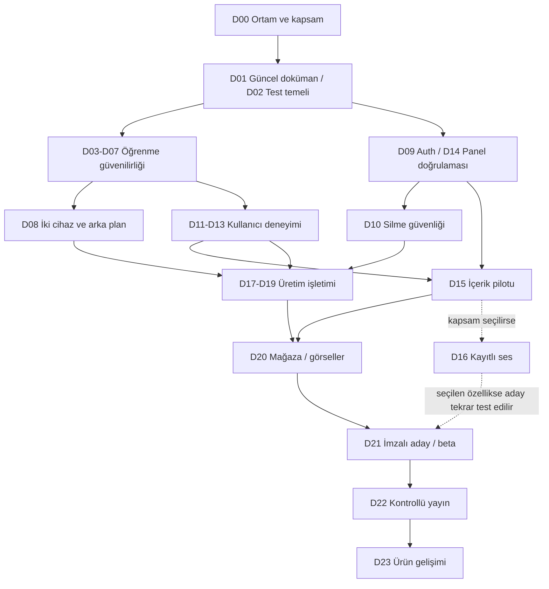

> **19 Ekim 2026:** Aktif öncelik ve gelecek planı [90 günlük yol haritasında](ROADMAP_2026_Q4.md). Bu belgedeki eski durum/süre tabloları tarihsel ve teknik referanstır; yayın durumu için [50 kaydı](RELEASE_50_STATUS.md) esas alınır.

# English Tales — tüm proje için aşamalı geliştirme haritası

> Başlangıç incelemesi: 13 Ekim 2026, native `357abed`. Satır numaraları bu snapshot içindir. GitHub geçişi sonrası güncel kaynak ve doğrulama durumu için [geçiş kaydı](NATIVE_MIGRATION.md) ve [ürün planı](PRODUCT_ROADMAP.md). Aşağıdaki inceleme sırasında test çalıştırılmadığına ilişkin ifadeler tarihsel inceleme kapsamını belirtir; yeni test sonuçları geçiş PR'ında kayıtlıdır.

13 Ekim 2026 · `codex/native-release-preparation` · `357abedb68c7194aab6b6f652fd5bfc2fe2d8598`

**Kapsam:** Mevcut native Android ürününü güvenilir öğrenme akışından üretim yayınına, ardından ölçümlü ürün gelişimine taşıyan plan. Bu belge geliştirme uygulaması değildir; kod, bağımlılık, veritabanı veya canlı hizmet değiştirilmedi.

Dayanak: [onaylanan kaynak haritası](CODEBASE_MAP.md) ve [243 dosyanın envanteri](CODEBASE_INVENTORY.tsv).

## 1. Başlangıç durumu ve planın sınırı

| Alan | Kaynakta mevcut | Geliştirme planındaki karşılığı |
|---|---|---|
| Android | Kotlin/Compose; 36 ana Kotlin dosyası; SDK36/min24; paket 47/2.0.0 | Yeni uygulamayı yeniden kurmak yerine mevcut akışları iyileştirme ve kanıtlama. |
| Öğrenme | Okuyucu, çeviri, kelime defteri, dört oyun, günlük hedef, seri/puan/rozet | Doğru kayıt, hata görünürlüğü, zaman/sürüm koruması, erişilebilirlik ve içerik yeterliliği. |
| Kalıcılık | Room6; owner başına DB; outbox, session draft, guest transfer, cloud baseline | Migration ve immutable event sözleşmesini koruyan değişiklikler. |
| Hesap | Google/e-posta, OTP, recovery, şifreli oturum, hesap silme | Yeni auth yazımı değil; bu Mac, gerçek hizmet ve Play paketinde uçtan uca kabul. |
| Eşitleme | Foreground + WorkManager; upload/pull, CAS tercih çatışması | Gerçek ikinci cihaz, kesinti/işlem kaybı, bilinmeyen kelime ve arşivlenmiş kaynak kontrolü. |
| İçerik/panel | Supabase model, RLS, sürümlü yayın, medya, audit, backup/recovery | Katalog genişletme, editör kalitesi, gerçek çok editörlü ve yarım kalan medya işlemleri. |
| Test tanımları | 106 cihaz + 11 JVM + 50 backend; altı ELF regresyon testi | Bu sayılar başlangıç envanteridir. Bu görevde test çalıştırılmadı. |
| Release | Kaynakta production config, signing guard ve paket denetimi | Bu Mac'te signing.properties yok; eski makinedeki imza/yayın kayıtları güncel yerel hazır oluş değildir. |

Kayıt/kurtarma/silme, Google üretim bağlantısı, HTTPS panel ve imzalı 47 paketi için 11 Ekim tarihli çalışma kayıtları bulunuyor. Bunları **tarihsel kanıt** olarak kullanıyoruz; mevcut ortamda yeniden doğrulama gerekir. [Hesap sonucu:50](ACCOUNT_LIFECYCLE_EXECUTION.md), [üretim girişleri:9](PUBLIC_RELEASE_OPERATIONS.md), [paket sonucu:18](PRODUCTION_PACKAGE_PLAN.md).

Eski ARCHITECTURE/PRODUCT_SPEC/STORE_RELEASE_ROADMAP metinlerindeki Room4/5, “hesap yok”, “eşitleme yok”, “panel yerel” ifadeleri kaynakla uyuşmuyor. Planın başlangıç noktası bu tarihsel başlangıç tabloları değil, güncel kod haritasıdır.

**Öncelikler:** P0 = hesap/veri güvenliği veya yayına çıkış için zorunlu kapı; P1 = ana öğrenme deneyimi ve güvenilirlik; P2 = iyileştirme veya sonraki ürün aşaması. Bunlar kusur şiddeti iddiası değildir.

**Kanıt türleri:** K = kodda görülen davranış; T = tarihsel kayıttaki sonuç; H = yeniden üretilecek hipotez; Ö = ürün/uygulama önerisi. İş paketleri bu ayrımı korur.

**Süre:** Gün/hafta tahmini verilmedi. İlk baseline ve ilk düzeltme tamamlanınca gerçek derleme, cihaz testi ve inceleme süreleriyle takvim çıkarılabilir. Sahte kesinlik üretmek yerine her paketi bağımsız kabul ve teslim ölçütleriyle planlıyoruz.

## 2. Aşamalar ve geçiş kapıları

| Aşama | Paketler | Amaç | Sonraki aşamaya geçiş kanıtı |
|---|---|---|---|
| A0 — Geliştirme temeli | D00–D02 | Güncel kararlar, tekrarlanabilir kurulum, test/CI temeli | Ortam manifesti, güncel durum tablosu, test raporları ve izole cihaz testi. |
| A1 — Öğrenme güvenilirliği | D03–D07 | Hesap/kelime/kayıt/süre kaynaklı açık noktalar | Risk senaryosu yeniden üretilmiş veya çürütülmüş; gerekli düzeltmeler ilgili regresyonla kabul edilmiş. |
| A2 — Hesap ve iki cihaz | D08–D10 | Gerçek eşitleme, oturum ve silme doğruluğu | İki cihazda aynı hesap, kesinti/replay/CAS; kayıt/kurtarma/çıkış/silme sonuçları. |
| A3 — Ana kullanıcı yolculukları | D11–D13 | Akıcı ve erişilebilir okuma/alıştırma/katalog deneyimi | UI senaryoları, küçük ekran/büyük yazı/TalkBack, tarih ve devam konumu kontrolleri. |
| A4 — İçerik ve yayıncı süreci | D14–D16 | Doğru içerik, güvenilir editör akışı, ses kapsamı | Editör checklist'i, sürüm/medya işlemleri ve içerik pilotu. D16 isteğe bağlıdır. |
| A5 — Üretim işletimi | D17–D19 | Canlı yetki sınırları, geri yükleme ve performans | Erişim matrisi, izole hosted restore, ölçüm raporu ve müdahale prosedürü. |
| A6 — Paket ve yayın | D20–D22 | Mağaza sunumu, aynı adayda beta ve kontrollü yayın | Son aday hash/imza/servis/16 KiB/UI kanıtı, Console kontrolleri, yayın kararı. |
| A7 — Yayın sonrası ürün gelişimi | D23 | Geri bildirim ve öğrenme ihtiyacına göre büyüme | Ölçüm/ürün hipotezleri ve sonraki özellik kararları. |

Bağımsız alanlar eşzamanlı planlanabilir; shared SQL, LearningStore, LearningViewModel veya aynı artifact'i değiştiren işler sıraya alınır. Grafik paket düzeyinde özettir; aşağıdaki bağımlılık listeleri belirleyicidir.

## 3. Ayrıntılı iş paketleri

### D00 — Ortam, ürün sınırları ve başlangıç kanıtı

**Aşama:** A0 · **Öncelik:** P0 · **Bağımlılık:** yok · **Tür:** K/T/Ö · **Teslim:** tek kurulum ve karar kaydı.

- Debug/test/production URL ve package/signature ayrımını kaydet; bu Mac'in JDK17/SDK36/Gradle ortamını tekrar kurulabilir tarif et. Gizli anahtarları depoya veya rapora alma.
- Debug sertifikası/Google client uyumunu ve release anahtarının bu makinede kullanılabilirliğini kontrol et. Eski emülatörü ve kullanıcı verisini koru; ayrı test cihazını kullan.
- İlk native yayın için dil, hedef yaş, ücretsiz/reklamsız kapsam, TTS/kayıtlı ses ve eski Expo verisinin davranışını karar tablosuna koy. Mevcut belgelerde eski Expo öğrenme taşıması yok; bunun kabulü ayrıca teyit edilmeli.
- İmzalama anahtarı veya mevcut yedek elde edilemiyorsa bunu blocker olarak kaydet; yeni uygulama kimliği ya da veri silme ile dolanma.

**Dosya alanı:** [app/build.gradle.kts:11](../app/build.gradle.kts), [production.properties:1](../config/production.properties), [README:37](../README.md), örnek properties ve kurulum dokümanları. Yerel özel ayarlar Git dışıdır.

**Kabul:** temiz checkout'tan debug derlemesi tarifle çalışır; hangi build'in hangi servise gittiği belirlenebilir; debug sertifika ve release key durumu açık; kapsam kararları mevcut.

### D01 — Dokümantasyonu mevcut sisteme eşitleme

**Aşama:** A0 · **Öncelik:** P1 · **Bağımlılık:** D00 · **Tür:** K/T · **Teslim:** doküman PR'ı.

- ARCHITECTURE, PRODUCT_SPEC, README, SYNC_CONTRACT ve eski roadmap içindeki başlangıç durumlarını tarihsel olarak etiketle; güncel Room6, auth/sync/content/hosting sınırlarını tek tabloda göster.
- “Kaynakta mevcut / tarihsel doğrulama / bu ortamda geçti / açık kabul / ürün kararı” durumlarını ayır.
- Mevcut 106/11/50 test tanım sayısı ile çalıştırılan test sonuçlarını aynı ifade içinde karıştırma.

**Dosya alanı:** [ARCHITECTURE:28](../ARCHITECTURE.md), [PRODUCT_SPEC:36](../PRODUCT_SPEC.md), [README:45](../README.md), [SYNC_CONTRACT:151](../backend/SYNC_CONTRACT.md), yayın notları.

**Kabul:** bir geliştirici eski Expo komutlarına veya “eşitleme henüz yok” ifadesine göre iş başlatmaz; açık işleri yalnızca tarihsel eksik listesinden türetmez. Kod davranışı değişmez.

### D02 — İzole ve gerçekten çalışan regresyon temeli

**Aşama:** A0 · **Öncelik:** P0 · **Bağımlılık:** D00 · **Tür:** K/Ö · **Teslim:** test altyapısı + CI PR'ı ve baseline sonuçları.

- Mevcut JVM/backend testleri, Android lint ve cihaz testleri için baseline al; ilk hatayı düzeltme kapsamını test altyapısına karıştırmadan ayır.
- CI'da yalnızca androidTest APK üretimini başarı sayma: seçilmiş cihaz testlerini ve tam veri/hesap regresyonunu izole emülatörde çalıştıracak görev tanımla.
- Hosted içerik testini yerel/fake testlerden ayır; ayar yoksa atlanan canlı test görünür raporlansın. CI kişisel hesabı veya production client ayarını otomatik kullanmasın.
- Compose UI test altyapısını mevcut BOM ile uyumlu ekle; framework/beta sürüm yükseltmesini bu işin gereksiz ön koşulu yapma.

**Dosya alanı:** [.github/workflows/verify.yml:51](../../.github/workflows/verify.yml), [app/build.gradle.kts:112](../app/build.gradle.kts), [RemoteContentTest:115](../app/src/androidTest/java/com/yurken/englishtales/data/RemoteContentTest.kt), androidTest/test/backend tests.

**Kabul:** raporda run/pass/fail/skip ayrı; cihaz testi sonucu gerçekten cihaz yürütmesinden gelir; başarısız test CI'ı durdurur; kullanıcı DB'si veya Auth hesabı etkilenmez. Compose eylem ve assertion'ları semantik düğümlere bağlanır. [Resmi Compose test yaklaşımı](https://developer.android.com/develop/ui/compose/testing/apis)

### D03 — Hesaba uygun günlük hatırlatıcı

**Aşama:** A1 · **Öncelik:** P1 · **Bağımlılık:** D02 · **Tür:** K/H/Ö · **Teslim:** odaklı düzeltme + regresyon.

- Receiver'ın Guest store açtığı davranışı A/B/misafir senaryosuyla yeniden üret.
- Hatırlatıcı kullanıcı tercihini cihaz genelinde mi, hesap başına mı tutacağımızı D00 kararına bağla; hedef kontrolünde aktif owner seçimini tek noktada yap.
- Giriş/çıkış/silme/hesap değişimi, bildirim izni reddi, reboot ve timezone değişimindeki alarm davranışını doğrula.

**Dosya alanı:** [LearningReminders:63](../app/src/main/java/com/yurken/englishtales/ui/LearningReminders.kt), [LearningStore:30](../app/src/main/java/com/yurken/englishtales/data/LearningStore.kt), LearningSyncRuntime.accounts, TalesApp lifecycle; gerekirse yeni reminder owner testleri.

**Kabul:** aktif owner hedefi tamamladıysa bildirim gönderilmez; başka hesabın/misafirin hedefi kararı bozmaz; izin kapalıyken alarm UI'ı yanıltmaz; owner bulunamama için veri silmeyen belirli davranış vardır.

### D04 — Başarısız kalıcı işlemi doğru ekranda gösterme

**Aşama:** A1 · **Öncelik:** P1 · **Bağımlılık:** D02 · **Tür:** K/H/Ö · **Teslim:** UI hata sözleşmesi + regresyon.

- VM mutation hatalarının yalnızca AccountState mesajına gittiği yolu okuyucu/oyun/ayar üzerinden hata enjeksiyonuyla doğrula.
- Kullanıcıya “kaydedildi” veya “tamamlandı” demeden kalıcılık sonucunu UI'a bağla; kullanıcı metni sade, teknik tanılama kodu güvenli olsun.
- Coroutine iptalini gerçek işlem hatasından ayır; ekrana taşınan hata eski account.scope'tan yeni hesaba sızmasın.
- Retry aynı olayı ikinci ödülle yeniden üretmesin; transient UI olayı process/rotation sonrasında nasıl gösterilecek belirle.

**Dosya alanı:** [LearningViewModel:51](../app/src/main/java/com/yurken/englishtales/data/LearningViewModel.kt), TalesApp, ReaderScreen, PracticeScreen, LearningJourney, AccountSwitchTest/LearningStoreTest.

**Kabul:** DB/outbox yazımı başarısızsa aynı ekranda anlaşılır uyarı; eski owner'ın hatası yeni owner'a gösterilmez; retry veya çift tıklama çift kayıt/puan üretmez; sır ve payload hata metnine girmez.

### D05 — İkinci cihazdaki bilinmeyen ve arşivlenmiş kelimeler

**Aşama:** A1 · **Öncelik:** P0 · **Bağımlılık:** D00, D02 · **Tür:** K/H/Ö · **Teslim:** veri sözleşmesi kararı → resolver/cache ve gerekirse migration.

- CloudLearningWord kaynak revision ID taşıyor; reconciliation kelime ID/state'i yerel DB'ye yazıyor; SavedWordsScreen yalnızca LearningContent.words'teki tanımları gösteriyor. Yeni cihazda indirilmemiş kelimenin görünmeme hipotezini üret.
- Arşivlenmiş story RLS nedeniyle anonim okunamayabilir. Genel katalog yetkisini genişletmek yerine kullanıcıya ait öğrenme kelimesini güvenli çözme sözleşmesini tasarla; iki seçenek: owner-scoped sınırlı kelime snapshot'ı veya yetkili revision/word resolver. Payload ve eski client uyumu test edilmeden seçim kesinleşmez.
- Çözülmüş tanımı offline sakla; çözüm hatasında kaydedilmiş ID/state'i silme. UI sayı/liste farkını ve retry durumunu açık göster.
- `discover`/`kind` gibi source bulunmayan eski olaylar için immutable JSON'u değiştirme veya sahte revision üretme. Yerel-only/eski olay durumunu koru; gerekiyorsa ayrı, açıkça tanımlı yeni olay/migration politikası tasarla.

**Dosya alanı:** [LearningCloudSnapshot:15](../app/src/main/java/com/yurken/englishtales/data/LearningCloudSnapshot.kt), [Reconciliation:97](../app/src/main/java/com/yurken/englishtales/data/LearningReconciliation.kt), [SavedWordsScreen:267](../app/src/main/java/com/yurken/englishtales/ui/CatalogScreens.kt), LearningContent, RemoteContent, Store, snapshot/content/learning SQL; yeni schema gerekiyorsa Room migration ve schema export.

**Kabul:** story indirilmemiş ikinci cihaz kelime/çeviri/stage'i görebilir ve offline çalışabilir; arşivli kaynaktan gereken kelime çözülürken taslak veya başkasının verisi açılmaz; migration eski kelimeleri/outbox'ı korur; blocked event gövdesi değiştirilmez.

### D06 — Çok sözcüklü ifade ve kelime eşleştirme tutarlılığı

**Aşama:** A1 · **Öncelik:** P1 · **Bağımlılık:** D02, D05 · **Tür:** K/H/Ö · **Teslim:** ortak davranış sözleşmesi + okuyucu/panel regresyonu.

- Panel ve SQL'in kabul ettiği ifadelerle Android'in tek-token alt çizme davranışını karşılaştır.
- Noktalama, tire, kesme işareti, büyük/küçük harf ve üst üste gelen kelime/ifade için tercih sırasını tanımla.
- Aynı cümlede yalnızca bağlı kelime/ifadeler seçilebilsin; render ve tap alanı anlam ID'sine bağlansın. Mevcut kelime ID'leri korunur.

**Dosya alanı:** [ReaderScreen:195](../app/src/main/java/com/yurken/englishtales/ui/ReaderScreen.kt), LearningContent.wordsForStory, admin/workflow.js, admin/app.js highlight, publication_word_links trigger ve admin-client tests.

**Kabul:** “picked up”, “picked-up”, kesme işaretli sözcük ve substring negatif testleri; panelde geçerli olan öğrenme öğesi okuyucuda doğru öğe olarak açılır; eski bundled tek sözcükler aynı ID ile çalışır.

### D07 — Okuma/oyun oturumu ve TTS yaşam döngüsü

**Aşama:** A1 · **Öncelik:** P1 · **Bağımlılık:** D02 · **Tür:** K/H/Ö · **Teslim:** lifecycle doğrulaması ve yalnızca bulunan kusurların düzeltmesi.

- Sayfa/revision değişimi, rotation, process kill, arka plan/geri dönüş, completion ve abandon sırasında session ID, cursor ve activeMillis'i izle.
- TTS başlatılamaması, dil verisi olmaması, hızlı sayfa geçişi, ekrandan çıkış ve ses kesintilerinde tutarlı stop/dispose davranışı tanımla.
- Mevcut beş saniyelik checkpoint sınırını ölç ve dokumente et; ani process kill için sıfır süre kaybı vaadi verme.
- ClickableText deprecation'ını bağımsız okuyucu dokunma/semantics değişikliğiyle ele al; geniş Compose yükseltmesini zorunlu kılma.

**Dosya alanı:** ReaderScreen/Narrator, TalesApp reader route, ActiveLearningTime, ForegroundLearningClock, Store/session_drafts, LearningStoreTest ve ForegroundLearningClockTest.

**Kabul:** devam aynı revision/cümlede; pause süresi aktif süreye katılmaz; tamamlanmış oturum bir kez ödül verir; terk edilen oturum ödül vermez; TTS bulunmasa okuma akışı sürer; dispose sonrası eski callback state'i değiştirmez.

### D08 — Gerçek iki cihaz ve arka plan eşitlemesi

**Aşama:** A2 · **Öncelik:** P0 · **Bağımlılık:** D02, D05 · **Tür:** T/H/Ö · **Teslim:** iki izole cihaz/hesap senaryo raporu; kusur varsa odaklı düzeltme.

- Aynı test hesabıyla iki emülatör: farklı offline oturumlar, save/remove/review, farklı revision cursor'u, tercih CAS çatışması, guest transfer.
- Ağ kaybı server kabulünden sonra olursa aynı UUID/body replay ve `applied=false` acknowledgement davranışını doğrula.
- Foreground ve Worker yarışması, çıkış/hesap değişimi sırasında geç yanıt, 401/429/5xx/backoff ve process restart'ı dene.
- Zorla durdurma ile doğal process kaybını ayrı değerlendir; background job'ın kesin saatinde çalışacağı vaadi verme.

**Dosya alanı:** LearningAccountSync, LearningSync, LearningReconciliation, LearningPreferencesSync, LearningSyncRuntime, LearningViewModel; ilgili altı sync/reconciliation/worker test dosyası.

**Kabul:** pending kuyruğu boşaldığında iki cihazın server kaynaklı history/word/progress/preference sonucu aynı; eski device-only baseline farkı ayrıca görünür; çift puan yok; geç yanıt yeni hesaba uygulanmaz; Worker ve UI ortak kilidi ihlal etmez. WorkManager entegrasyon testleri mevcut test altyapısını kullanır. [Resmi WorkManager test rehberi](https://developer.android.com/develop/background-work/background-tasks/testing/persistent/integration-testing)

### D09 — Bu ortam ve release için gerçek hesap kabulü

**Aşama:** A2 · **Öncelik:** P0 · **Bağımlılık:** D00, D02 · **Tür:** T/H · **Teslim:** Auth kabul matrisi.

- Bu Mac debug sertifikası, web client ve production/test provider eşleşmesini kontrol et; gerekli hesap girişini kullanıcı yapar.
- Ayrı geçici hesapla kayıt/OTP/resend/recovery; yanlış/expired/used kod, yanlış parola, throttling ve offline restore senaryoları.
- Token expiry/refresh; A→guest→B; signout sırasında devam eden istek; kapat/aç sonrası doğru owner DB.
- Aynı kabulün Play imzalı adaydaki kısmı D21'de tekrar çalışır. Debug Google girişi mağaza imzası kanıtı değildir.

**Dosya alanı:** AccountSession/AuthHttp/EncryptedSessionStorage, GoogleIdentity, LearningViewModel, AccountScreen/WelcomeScreen ve account testleri; dış provider/client ayarları ayrıca izlenir.

**Kabul:** doğru owner ve oturum korunur; recovery başka hesabın DB'sini açmaz; credentials log/kalıcı yedeğe girmez; rate limit mesajı teslim iddiasında bulunmaz; test/parola/kod girişini kullanıcı kontrol eder.

### D10 — Hesap silme ve yayıncı medyası için uçtan uca güvenlik

**Aşama:** A2 · **Öncelik:** P0 · **Bağımlılık:** D09 · **Tür:** K/T/H · **Teslim:** geçici test hesabıyla server + client kanıtı.

- Kişisel veya gerçek yayıncı hesabı yerine ayrı test ortamında geçici owner/publisher ve ona ait test medyası kullan.
- Silmeden önce öğrenme/tablo/Storage inventory sayıları kaydet; recent-session gereksinimi, unknown file/hash mismatch/PUT hatası ve retry sırasında durumu izle.
- Sunucu onayını aldıktan sonra process kill: cleanup receipt sonraki açılışta yalnız doğru hesabı temizlesin; guest ve başka hesap korunsun.
- Eski access/refresh token için Auth, private learning ve sensitive RPC sonuçlarını ayrı kaydet. Sadece public katalog hâlâ okunabiliyor diye güvenlik hatası sayma.

**Dosya alanı:** delete-account handler/index, deletion authorization/media inventory SQL, AccountService.deleteAccount, DeletedAccountCleanup, Store.eraseDeletedAccount, guest transfer receipts ve deletion/account-switch tests.

**Kabul:** dolu öğrenme verisi doğru user için temizlenir; ortak yayın medyası checksum ile korunur; diğer owner verisi değişmez; eski refresh oturumu tekrar token üretemez; hassas işlemler silinen session'ı kabul etmez; kısmi hata silindi diye raporlanmaz.

Supabase silinen kullanıcıya önceden verilmiş access JWT'nin süre dolana kadar geçerli kalabileceğini belirtir. Bu yüzden “silme sonrası bütün istekler anında 401” kabulü yerine özel veri ve hassas işlemler için gerçek erişim sınırını ölçeriz. [Supabase kullanıcı silme davranışı](https://supabase.com/docs/guides/auth/managing-user-data), [Storage sahipliği](https://supabase.com/docs/guides/storage/security/ownership).

### D11 — Ana öğrenme yolculuğunu UI testlerine bağlama

**Aşama:** A3 · **Öncelik:** P1 · **Bağımlılık:** D03, D04, D05, D06, D07 · **Tür:** Ö · **Teslim:** az sayıda güçlü Compose uçtan uca test + ekran kanıtı.

- Misafir → onboarding → ilk hikâye → çeviri/kelime kaydet → tamamla → kelime çalış → günlük plan.
- Aynı yolculukta back, hızlı çift tıklama, account change, indirme hatası ve uygulamayı tekrar açma.
- Ekran text/semantics, beklenen store/snapshot ve outbox/server boundary'lerini doğrula; sadece screenshot veya widget varlığıyla başarı ilan etme.

**Dosya alanı:** TalesApp, Welcome/Onboarding/CatalogScreens, Reader/Practice/Games, LearningJourney, ReferenceComponents; yeni Compose UI testleri henüz oluşturulmadı.

**Kabul:** kullanıcının ana görevi tamamlanır; doğru kelime/konum/ödül saklanır; geri dönüşte konum kaybolmaz; hata yolu kullanıcıyı tekrar deneyebileceği noktaya getirir. UI semantik seçicileri ölçülebilir davranışı hedefler. [Compose test API'leri](https://developer.android.com/develop/ui/compose/testing/apis)

### D12 — Küçük ekran, büyük yazı ve erişilebilirlik

**Aşama:** A3 · **Öncelik:** P1 · **Bağımlılık:** D11 · **Tür:** Ö · **Teslim:** ekran matrisi ve ilgili UI düzeltmeleri.

- Dar/kısa ekran ve büyük fontScale; account keyboard/IME; reader/gece modu; games/result/settings; sistem çubukları ve rotation.
- TalkBack sırası/label/role/selected durumu, kelime seçimi ve progress; touch target ve contrast ölçümü.
- UI'ı sadece sabit dp küçülterek toparlama; shared theme/component değişiminin bütün ekran etkisini kontrol et.

**Dosya alanı:** ReferenceComponents, Theme, AccountScreen, CatalogScreens, ReaderScreen, GameViewport/Practice/Flashcard/Matching, LearningJourney ve XML theme.

**Kabul:** ana görevler büyük yazı ve TalkBack ile yapılabilir; keyboard temel eylemi kapatmaz; yatay/dikey geçiş kaydı bozmaz; her bulunan kusur için ilgili ekran/semantics kanıtı tutulur.

### D13 — Katalog sıralaması ve devam/öneri doğruluğu

**Aşama:** A3 · **Öncelik:** P1 · **Bağımlılık:** D05, D11 · **Tür:** K/H/Ö · **Teslim:** metadata/sıralama sözleşmesi + katalog regresyonu.

- Mevcut “Yeni hikâyeler” son üç liste elemanını alır; uzak katalog ID sırasıyla gelir. Yayın zamanı ile “yeni” etiketini eşleştir.
- Bundled hikâye için timestamp yoksa tutarlı fallback; yeni metadata için eski cache decode uyumu.
- Tamamlanan/current/historical revision, arşivlenen ama indirilmiş hikâye, boş katalog ve level/genre filtrelerini birlikte doğrula.
- Öneriyi önce seviye/tür/okuma durumu üzerinden açıklanabilir tut; ML/AI önerisini bu düzeltmenin bağımlılığı yapma.

**Dosya alanı:** [CatalogScreens:116](../app/src/main/java/com/yurken/englishtales/ui/CatalogScreens.kt), [RemoteContent:154](../app/src/main/java/com/yurken/englishtales/data/RemoteContent.kt), Story/ContentCodec, LearningJourney/DailyPlan, recommendedStory.

**Kabul:** ID alfabetik sırası yeni yayımlanma sırası gibi gösterilmez; old cache açılır; her progress kendi revision'ına aittir; recommendation bir olmayan/okunamaz story rotasına düşmez.

### D14 — Gerçek editör/yayıncı çalışma akışları

**Aşama:** A4 · **Öncelik:** P1 · **Bağımlılık:** D02 · **Tür:** T/H · **Teslim:** panel senaryo raporu; bulunan kusurlar için küçük PR'lar.

- İki editör aynı draft; stale version; publish sırasında child edit; iki publisher archive/publish yarışı.
- Upload ortasında hata, metadata oluşup Storage oluşmaması, reserved delete yarım kalması; referanslı medyanın korunması.
- Session expiry/refresh sırasında yerel metin yedeği; farklı user/project/revision yedeğinin reddi; dirty navigation.
- Preview ile Android aynı kelime/cümle ilişkisini göstermeli; D06'ın phrase sözleşmesi panelde uygulanmalı.

**Dosya alanı:** admin app/api/workflow/server; content/admin/completion SQL; admin-client/backend tests ve verify-admin-http.

**Kabul:** stale edit yeni metni ezmez; yayımlanmış sürüm/medya değişmez; upload/delete sonrası orphan state belirlenebilir ve güvenli toparlanır; backup kimlik sınırı korunur; editor yayıncı işlemi yapamaz.

### D15 — İçerik kalite ve düzenli yayın üretimi

**Aşama:** A4 · **Öncelik:** P1 · **Bağımlılık:** D00, D05, D06, D14 · **Tür:** Ö · **Teslim:** içerik checklist'i + küçük pilot katalog.

- Mevcut altı hikâyeyi İngilizce seviye, doğal Türkçe çeviri, bağlamsal kelime anlamı, cümle bağlantısı ve kapak hakları açısından gözden geçir.
- Paket örnek kelimelerinin gerçek published source ilişkisini tamamla; geçmiş blocked event'leri sessizce yeniden yazma.
- Önce birkaç hikâye ile editor→publish→mobile→offline→word practice hattını kabul et; sonra seviye/tür dengesiyle katalog büyüt.
- Eski plandaki 18–30 hikâye hedefini mağaza zorunluluğu değil ürün önerisi olarak tut. İlk 7–14 günlük öğrenme çeşitliliğini pilotla değerlendir; kesin sayı D00 içerik kapasitesi kararına bağlı.
- İçerik hatası → destek kaydı → immutable yeni revision → cached reader davranışı için süreç.

**Dosya alanı:** catalog/v1.json, LearningContent, exporter/seed/asset manifest, editor/client, cover assets ve CONTENT_GUIDE/ASSET_NOTES.

**Kabul:** örnekten canlı yayına bir tam hikâye hattı kanıtlanır; her öğenin editör/hak/sürüm kaydı var; kelime anlamı ve ID bağlantısı doğru; yayın sonrası eski reader revision'ı kaybolmaz.

### D16 — Kayıtlı ses desteği — kapsam seçilirse

**Aşama:** A4 · **Öncelik:** P2 · **Bağımlılık:** D00, D07, D14 · **Tür:** K/Ö · **Teslim:** özellik kararı; seçilirse ayrı ses indirme/oynatma işi.

- Panel audio_asset_id yükleyebiliyor, Android Story/Narrator bu dosyayı tüketmiyor. TTS ile ilk yayın yeterliyse bu paket sonraya bırakılır.
- Kayıtlı ses seçilirse revision-bound audio metadata, checksum/boyut, offline cache, indirme bütçesi, oynatma lifecycle ve TTS fallback tasarla.
- Cümle/ses zaman eşlemesi ayrıca içerik sözleşmesi ister; bu veri hazır olmadan senkron vurgulama vaat etme.

**Dosya alanı:** Story/ContentCodec/RemoteContent, Reader/Narrator, ContentDownloads, panel audio alanları ve content_assets; cache biçimi değişirse uyumluluk testi.

**Kabul:** hakları belirli ses aynı revision'a aittir; bozuk/eksik dosya okuma akışını bozmaz; offline playback ve pause/dispose doğrudur; mağaza “dinle” vaadi gerçek uygulanan kapsamla eşleşir.

### D17 — Üretim schema/yetki/config eşleşmesi

**Aşama:** A5 · **Öncelik:** P0 · **Bağımlılık:** D05, D09, D10, D14 · **Tür:** H · **Teslim:** canlı erişim/config matrisi ve gerekirse düzeltme migration'ı.

- Repo migration/function/grant/policy tanımlarını gerçek test/production ile karşılaştır; drift raporu oluştur.
- Anon, iki normal user, editor, publisher ve server role için gerekli okuma/yazma/execute sınırları; credential denetimi.
- Public config, build config, Studio CSP/endpoint, Edge Function origin ve SupportLinks aynı hedefi göstermeli.
- Canlı mutation gerekirse D18 backup/restore kapısı ön koşuldur; yeni migration önce izole/test ortamında doğrulanır. Eski yayımlanmış client'larla uyum korunur.

**Dosya alanı:** sekiz SQL migration, config.toml, Edge Function, production.properties, app Gradle, build_hosting.py, SupportLinks ve hosted verification araçları.

**Kabul:** uygulamada yönetici key yok; başka user verisi alınamaz; normal user staff/publish yapamaz; published içerik anonymous okunur; schema/config drift kapatılmış veya kayıtlı yayın blocker'ıdır.

### D18 — Tam yedek ve hosted geri yükleme hazırlığı

**Aşama:** A5 · **Öncelik:** P0 · **Bağımlılık:** D00, D09 · **Tür:** T/H/Ö · **Teslim:** kapsam/saklama/restore runbook'u ve izole hosted kanıtı.

- Mevcut backup_public_content yalnızca reader-visible yayın + medya; local PGlite restore tam Auth/learning/disaster recovery değildir.
- Tam ihtiyaç envanteri: yayın/taslak/arşiv/audit, öğrenme, Auth/session ele alınışı, Storage bytes, config ve erişim rolleri. Hassas yedeği public repo/artifact yapma.
- RPO/RTO, sıklık, saklama, erişim ve sorumlu D00 ürün/operasyon kararlarıyla belirlenir; sayı varsayılmaz.
- Ayrı hosted test ortamında restore et; kayıt/mapping/hash ve client uyumunu doğrula. Silinen hesabı veya iptal edilmiş session'ı tekrar aktif etme stratejisi test edilsin.

**Dosya alanı:** backup_public_content, verify-content-restore, CONTENT_BACKUP_VERIFICATION, migration/seed ve ayrı restore operasyon araçları (henüz oluşturulmadı).

**Kabul:** kapsamın neyi içerip dışladığı açık; gereken kritik veri ve medya ayrı ortamda geri gelir; deleted-owner kayıtları hizmete yeniden açılmaz; üretime şema değişikliği için geri dönüş adımları uygulanabilir.

### D19 — Performans, dayanıklılık ve minimum tanılama

**Aşama:** A5 · **Öncelik:** P1 · **Bağımlılık:** D08, D11, D12 · **Tür:** Ö · **Teslim:** release ölçüm matrisi ve kusur/sınır raporu.

- Cold/warm açılış, büyük katalog/listeler, reader/bitmap memory, disk/ağ kullanımı ve Worker tekrarlarının pil etkisi için başlangıç ölçümü al.
- Önce baseline, sonra cihaz ve kullanıcı deneyimine göre performans hedefi koy; ölçülmemiş ms/FPS/çökmesiz yüzde yazma.
- API24 ve güncel API; düşük depolama, offline start, slow network, TTS yok, fontScale, process kill; ARM64 ve 16 KiB ortam sınırlarını ayrı raporla.
- Minimum tanılama: sürüm/build/safe error code/pending-blocked sayısı. E-posta/token/kod/parola/hikâye payload'ı loga girmez.
- Güncel pakette Analytics/Crashlytics yok; yeni SDK otomatik eklenmez. SDK/veri envanteri değişikliği D23 ürün kararı ve D20 beyan yeniden kontrolü gerektirir.

**Dosya alanı:** ViewModel/SyncRuntime, Reader/BookCover/RemoteContent, Catalog/Practice/Store; package/lint/ELF araçları, release docs.

**Kabul:** kritik çökme/ANR/veri kaybı senaryoları açık kalmaz; ölçümler cihaz/build ile bağlı; örnek sayısı ve gerçek donanım sınırı belirtilir; yavaş ağ yerel öğrenmeyi kilitlemez.

### D20 — Mağaza kapsamı, ikon ve veri beyanları

**Aşama:** A6 · **Öncelik:** P0 · **Bağımlılık:** D00, D12, D15, D17, D19 · **Tür:** T/Ö · **Teslim:** incelenebilir mağaza materyali ve beyan matrisi.

- İkon/launcher assets ve gerçek release UI ekranlarından mağaza görselleri; dil, açıklama, release notes ve support linkleri.
- Data Safety/yaş/içerik/izin/veri saklama-silme envanteri gerçek native SDK ve hizmetlerle eşleşsin; eski 46 aktif kalacaksa dağıtılan bütün sürümlerin davranışını değerlendir.
- SMTP, provider log/retention ve web beyanlarını canlı ayarlarla karşılaştır; repo politikası tek başına yapılandırma kanıtı değildir.
- Store yaş/test/target SDK gereksinimini yükleme anında Console ve resmi kaynakla tekrar kontrol et; eski roadmap tarihini bugünkü kural sayma.

**Dosya alanı:** mipmap/launcher XML, web privacy/delete/index, SupportLinks, STORE_DECLARATIONS_PLAN, store görselleri/sürüm notları.

**Kabul:** her mağaza vaadi test edilmiş özelliğe karşılık gelir; URL'ler çalışır; beyan-preview ile paket veri davranışı uyumlu; reviewer erişimi ayrı test hesabıyla tarifli; kişisel publisher hesabı paylaşılmaz.

### D21 — Son imzalı aday, Play güncelleme ve beta

**Aşama:** A6 · **Öncelik:** P0 · **Bağımlılık:** D08, D09, D10, D11, D12, D13, D15, D17, D18, D19, D20; D16 yalnız scope'a alınmışsa · **Tür:** T/H · **Teslim:** aynı final artifact üzerinde kabul paketi.

- En yüksek Play versionCode'u canlı kontrol et; yeni aday bunun üzerinde olsun. Kaynaktaki 47 değerini yüklenebilir yeni kod varsayma.
- İkon/metin/SDK/config dahil son değişikliklerden sonra signed APK/AAB üret; hash, signer, production DEX, test URL yokluğu, ELF/ZIP ve 16 KiB kontrollerini aynı çıktıda kaydet.
- Temiz kurulum + Play imzalı eski sürümden update; old Expo verisinin D00 kararıyla davranışı; native Room geçmişi/migration ve guest-account ayrımı.
- Play Store üzerinden paket edinme, Google giriş + kapat/aç, uygulamada OTP/kelime/offline/sync/permission ana yolları. Google'ın signed universal APK'sı manuel update ile yüklenirse bunu store/split testinden ayrı etiketle.
- Pre-launch report ve beta görevleri; başarısız test veya yeni ikon/SDK düzeltmesi olursa candidate hash değişir ve ilgili kabul tekrarlanır.

**Dosya alanı:** app Gradle/version/signing, production config, verify_release/verify_native_package/elf_alignment, releaseProbe ve PLAY_INTERNAL_TEST_PLAN/PAGE_SIZE_VERIFICATION.

**Kabul:** final hash ile test raporu eşleşir; gerekli main journeys release/R8 sürümde geçer; Play imzası OAuth'a uyumlu; upgrade veriyi D00 kararına uygun korur; store/split/fiziksel cihaz kanıtının sınırı açık. Android'in resmi rehberi native bağımlılıkları ve 16 KiB ortamda çalıştırmayı ayrıca doğrulamayı önerir. [16 KiB doğrulama rehberi](https://developer.android.com/guide/practices/page-sizes)

### D22 — Kontrollü üretim yayını ve ilk işletim

**Aşama:** A6 · **Öncelik:** P0 · **Bağımlılık:** D21 · **Tür:** Ö · **Teslim:** yayın kararı + müdahale/izleme kaydı.

- Yayın öncesi açık P0 kapıları, aday hash, schema/content revision ve mağaza preview birlikte gözden geçirilir.
- Production gönderimi/dağıtımı ayrı somut kullanıcı talimatıyla yapılır; bu harita üretim yayını başlatmaz.
- İlk gün/hafta support, giriş, indirme, eşitleme, crash/ANR ve içerik hatalarının owner'ı ve kontrol biçimi belirlenir.
- Problemde dağıtımı durdurma, içerik arşivleme veya daha yüksek versionCode düzeltme seçenekleri; eski Room APK'sına veri silerek downgrade yapma.

**Dosya alanı:** RELEASE_EXECUTION, PUBLIC_RELEASE_OPERATIONS, içerik/admin süreçleri; gerektiğinde yeni fix commit/migration, eski artifact ve kullanıcı verisi korunur.

**Kabul:** kim neyi hangi kanıtla yayımladığı belli; hata müdahalesi ve destek/silme talebi yolu işler; rollout'u durdurmanın kurulmuş APK'ları geri almadığı kayda alınır.

### D23 — Yayın sonrası öğrenme ve özellik keşfi

**Aşama:** A7 · **Öncelik:** P2 · **Bağımlılık:** D22 · **Tür:** Ö · **Teslim:** ölçülmüş ihtiyaçlara dayalı sonraki backlog.

- İlk hikâyeye ulaşma, okuma→kelime çalışması geçişi, zamanlı tekrar ve içerik hata geri bildirimini değerlendir. D1/D7 veya öğrenme sonucu için yeterli veri yoksa oran/etki iddiası üretme.
- Telemetry ihtiyacı varsa veri minimizasyonu, kullanıcı tercihi, SDK maliyeti ve privacy/Data Safety etkisiyle ayrı karar ver; Firebase ölçüm önerisi eski belgeye bakılarak otomatik uygulanmaz.
- Kayıtlı ses, gelişmiş öneriler, yeni dil/seviye ve içerik büyümesi için birer ürün hipotezi ve kabul hedefi.
- Sosyal/lig/referral, AI sohbeti, abonelik ve iOS her biri ayrı keşif, veri/maliyet/ürün haritası ister. Android yayın kapısını bunlara bağlama.

**Dosya alanı:** seçilen ürüne göre LearningPolicy/Journey/Content/Practice/Profile; telemetry veya yeni platform alanı henüz yok ve bu planla oluşturulmadı.

**Kabul:** yeni özellik kullanıcı ihtiyacı + başarı ölçütü + maliyet/veri etkisiyle seçilir; önceki Android veri/kimlik sözleşmesini koruyan ayrı uygulama planı bulunur.

## 4. İlk geliştirme sırası ve PR kapsamı

1. **D00:** Bu Mac için setup/config/signature ve ürün karar baseline'ı. Kod düzeltmesinden önce hangi ortamın test edildiği belirlenir.
2. **D02:** Mevcut testleri gerçekten çalıştırma ve cihaz/Compose test altyapısı. Yeni özellik yok.
3. **D03:** Hatırlatıcı owner seçimi. Küçük, bağımsız davranış değişikliği ve regresyon.
4. **D04:** Başarısız kaydın ilgili ekranda görünmesi. Genel UI yeniden tasarımı yok.
5. **D05:** Bilinmeyen/arşivli kelime sözleşmesi. Önce kabul fixture'ı ve tasarım, sonra client/server/cache/migration kapsamını küçük teslimlere bölme.
6. **D06/D07:** İfade seçimi ve lifecycle; her biri ayrı PR.
7. **D08/D09/D10:** Gerçek hesap/iki cihaz/silme kabulü. Başarısız kabul bulursa hedefli düzeltme; başarılı alan yeniden yazılmaz.

D01 doküman güncellemesi ve D14 panel kabulü, aynı merkezi dosyalar düzenlenmiyorsa bağımsız ilerleyebilir. D18 restore hazırlığı erken başlayabilir; canlı schema değişiklikleri bu kapı kapanmadan uygulanmaz.

## 5. Test ve kabul matrisi

| Kullanıcı senaryosu | Yerel/JVM/backend | Cihaz/Compose | Gerçek servis / Play | Sorumlu paket |
|---|---|---|---|---|
| Misafir onboarding → ilk okuma → kelime → oyun | Store/Policy/event assertion | Navigasyon, kelime, sonuç, reopen | Yayın katalog/offline download | D07, D11, D15 |
| Hesap A/guest/B ayrımı | Scope/owner/actor fixture | Ekran yeniden kurulumu, stale action | Auth/refresh | D04, D09 |
| Zamanlı kelime tekrarı / tombstone | Policy + SQL replay | Stage/list/practice | İki cihaz offline save/remove/review | D05, D06, D08 |
| Aynı olayın tekrar teslimi | UUID/body/applied/reconciliation | Kesinti ve restart | Server kabulünden sonra yanıt kaybı | D08 |
| Profil tercih çatışması | CAS/ack fixture | Yerel veya hesap seçimi | İki cihaz eşzamanlı edit | D08 |
| Günlük hatırlatıcı | Owner/goal seçimi | Notification/permission/reboot | Ağ bağımlılığı olmadan | D03 |
| Kayıt/OTP/recovery | Auth fake ve negatif input | Form/keyboard/session UI | Kullanıcı kontrollü test maili, provider log | D09 |
| Hesap silme | Handler/SQL/cascade/receipt | Ack sonrası kill ve temizlik | Geçici publisher medya + eski token | D10 |
| Panel iki editör / publish / media | PGlite/client/HTTP | Tarayıcı semantik akışı | Test ortamı gerçek Auth/Storage | D14, D17 |
| Yeni/archived revision ve offline | ContentCodec/cache/ID fixture | Katalog/reader pin/continue | Yeni yayın ve doğru sıra | D05, D13, D15 |
| Performans / 16 KiB | ELF/ZIP/DEX/signature | Release/R8 + 16 KiB environment | Play imzası/split/update, mümkünse fiziksel cihaz | D19, D21 |

**Kapanış kuralı:** Paket “kod var” diye tamamlanmaz. Kabul senaryosu, artifact/build/commit kimliği, pass/fail/skip, kullanılan environment ve kalan sınır kaydedilir. Değişiklik bir sözleşmeye dokunuyorsa client ve server tarafı birlikte doğrulanır.

## 6. Değişiklikten önce korunacak sözleşmeler

- Owner/account scope, encrypted session namespace ve database ownership.
- Transaction içinde yerel projection + immutable outbox; mevcut UUID/body tekrar koruması.
- Revision/sentence/word kimlikleri ve yayımlanmış içerik değişmezliği.
- Room schema geçmişi; yeni schema için veri silmeyen migration ve gerçek eski fixture.
- Source URL, capturedAt ve tam snapshot koruması; pending/tombstone/legacy baseline ayrımı.
- Sensitive auth/Storage işlemlerinde user/service role sınırı; public client'a yönetici key gitmemesi.
- Gizli bilgiler, kişisel hesaplar, mevcut emülatör verileri ve imzalı geçmiş artifact'lerin korunması.
- Production schema/client sürümleri arasındaki uyumluluk; canlı migration için D18 restore kapısı.

**Geri dönüş:** Kaynak değişimi ayrı revert/fix commit; yayın sonrasında daha yüksek versionCode; DB için veri koruyan forward migration. Git etiketi canlı Auth silinmesini veya Storage işlemini geri almaz.

## 7. Açık ürün kararları ve dış engeller

| Karar/engel | Neden şimdi kesinleştirilmiyor? | Nerede kapanır? |
|---|---|---|
| İlk yayın dilleri/yaş/gelir modeli | Tüm proje roadmap seçimi bu detayları seçmiş sayılmaz. | D00 |
| Eski Expo öğrenme verisi | Mevcut native transfer yalnız native local veriyi kapsıyor. | D00, D21 |
| Hatırlatıcı tercihi cihaz veya hesap geneli | Kod device-wide; ürün beklentisi ayrıca karar ister. | D03 |
| Kelime resolver payload/cache modeli | İkinci cihaz ve archived RLS kabulüyle en küçük uyumlu çözüm seçilmeli. | D05 |
| Kayıtlı ses | Backend mevcut, Android tüketimi yok; ilk yayın zorunluluğu seçilmedi. | D00, D16 |
| Physical cihaz erişimi | Önceki kayıtlarda yalnız emülatör vardı. Kullanıcıdan telefon satın alması varsayılmaz; emülatör sonucu fiziksel sonuç sayılmaz. | D19, D21 |
| İmzalama anahtarı/Play yetkisi | Bu Mac'te signing.properties yok; eski tarihsel başarı key erişimi sağlamaz. | D00, D21 |
| Hosted backup/restore altyapısı | Mevcut public-content yedeği kapsamı sınırlı. | D18 |
| Telemetry sağlayıcısı | Yeni SDK privacy/beyan/maliyet ve ürün kararı oluşturur. | D19 minimum tanılama, D23 karar |

## 8. Bu haritanın durumu

Bu plan, kullanıcı tarafından seçilen **tüm proje için aşamalı yol haritası** kapsamına göre hazırlandı. Kod uygulaması, canlı test, hesap oluşturma/silme, migration, Git push veya yayın işlemi yapılmadı. İlk somut geliştirme başlangıcı D00→D02; ilk odaklı davranış düzeltmesi D03 olarak öneriliyor.

Kaynak durumuyla doğrulanmış bulgular ve önerilen işler ayrıldı. Açık hipotezler kendi kabul testleriyle kapanacak; başarısızlığı yeniden üretilemeyen alanlar sırf refactor için yeniden yazılmayacak.

[24 iş paketinin kısa takip tablosu](DEVELOPMENT_BACKLOG.md)
