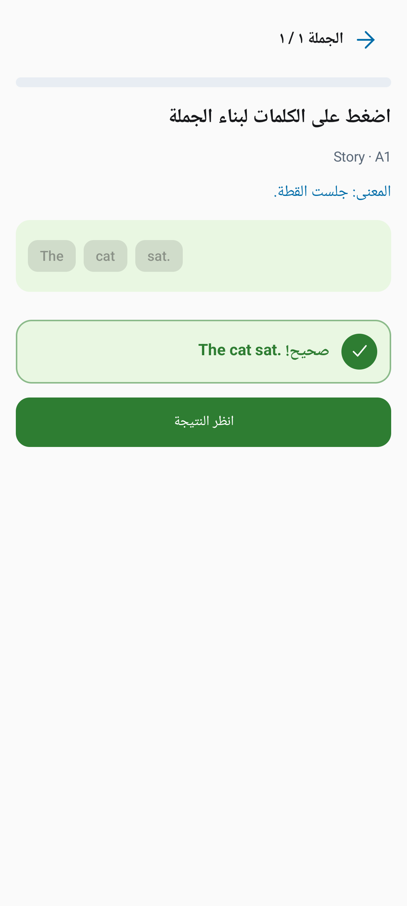
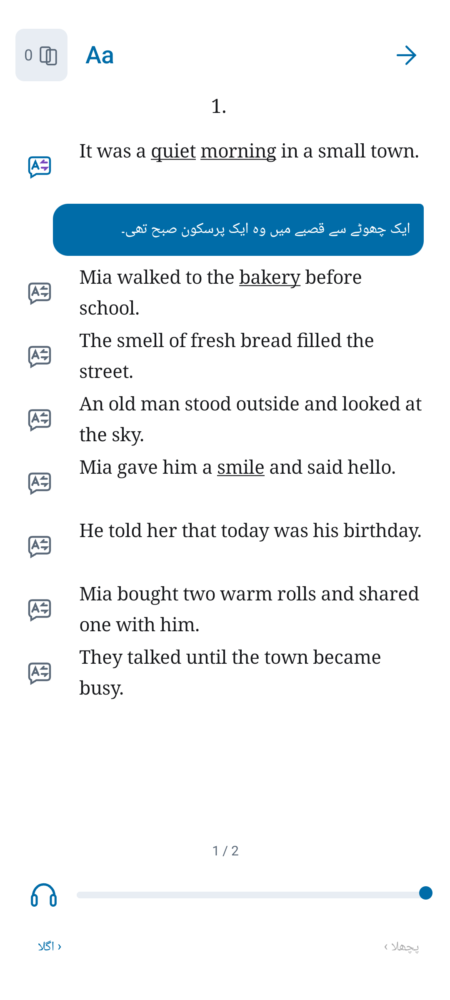

# Dil desteği — 10 yeni dil

18 Ekim 2026 · Çeviri kaynağı: Claude’un #90 çalışması (`8523eb3`). Uygulama entegrasyonu `codex/complete-ten-languages` dalındadır.

## Kullanım

İlk açılış ve Ayarlar ekranındaki **Uygulama dili** düğmesinden dil seçilir. Sistem dili seçeneği cihazın tercih sırasını izler. Android 13+ üzerinde uygulamanın sistem dil ayarıyla aynı LocaleManager kaydı kullanılır; Android 7–12’de yalnız bu cihaza ait tercih tutulur ve Activity yeniden oluşturulurken ViewModel/yazma kuyruğu korunur. Dil değişiminde öğrenme veritabanı, hesap, kaydedilen kelime kimlikleri, favoriler ve okuma konumları değiştirilmez. Dil değişince gezinme yeniden başlar; eski dildeki yarım bir alıştırmanın seçenekleri yeni dilde geri yüklenmez. Hesap ViewModel’i ve bekleyen yazma kuyruğu bu arayüz sıfırlamasının dışında kalır.

| Dil | İçerik kodu | Arayüz kaynağı |
| --- | --- | --- |
| Türkçe | tr | values + üretilen values-tr |
| İngilizce arayüz | Türkçe destek içeriği | values-en |
| Latin Amerika İspanyolcası | es-419 | values-b+es+419 |
| Brezilya Portekizcesi | pt-BR | values-pt-rBR |
| Endonezce | id | values-in (Android’in eski kaynak kodu) |
| Arapça | ar | values-ar |
| Vietnamca | vi | values-vi |
| Hintçe | hi | values-hi |
| Rusça | ru | values-ru |
| Bengalce | bn | values-bn |
| Urduca | ur | values-ur |
| Tayca | th | values-th |

İspanyolca bölgesel varyantları es-419’a, Portekizce varyantları pt-BR’ye eşlenir. Desteklenmeyen arayüz dilleri İngilizceye döner. İngilizce öğrenilen dildir: hikâyelerin İngilizce cümleleri, soru/cevap bankaları, telaffuz ve İngilizce örnekler çevrilmez.

## Kapsam ve çevrimdışı davranış

Her yeni dilde 50 hikâyenin açıklaması, 1.002 cümle, 359 öğrenme kelimesi, 5 kategori ve 3 tür çevirisi bulunur. Arayüzde her dil için 528 kaynak kimliği vardır; bu sayı çoğul kaynakları birer kimlik olarak sayar. Hesap/eşitleme/hata mesajları, bildirim ve widget kaynakları da bu kapsamın içindedir.

`tooling/build_translations.py` çeviri taslaklarını kimlik ve tamlık kontrolünden geçirip paket içi `catalog/v1.json` haritalarına ekler. Eski Türkçe alanlar, İngilizce metinler, hikâye/kelime kimlikleri, kapaklar ve revision kimlikleri korunur. Mevcut backend exporter ve editör bu dil haritalarını zaten destekler.

Canlı sunucunun ilgili dildeki çevirisi önceliklidir. Bulunmuyorsa `ContentTranslations` paket çevirisini **kaynak metni birebir eşleşen** içerikte kullanır. Böylece mevcut 50 canlı hikâye, üretimdeki değişmez revision’ları yeniden yayımlamadan yeni dillerde okunabilir. 18 Ekim kontrolünde 50 açıklamanın, 1.002 İngilizce cümlenin ve sunucudaki 622 revision-kelime satırının kaynakları paketle eşleşti.

Eski indirilmiş belgeler ve katalog her geri yüklemede seçili dilde çözülür. Ham belgeler, kapaklar ve indirme kimlikleri değiştirilmez. Eski dilde başlamış bir içerik isteğinin yeni dildeki kataloğu kurmasına izin verilmez. Paketle eşleşmeyen yeni/düzenlenmiş bir içerik henüz çevrilmemişse İngilizce kaynak gösterilir; açıklama için seçili dilde genel bir metin kullanılır. Sunucu çevirisi eklendiğinde o metin öncelik kazanır. Yeni içerik yayımlayan editör her açık dilin çevirilerini de tamamlamalıdır.

Paket içi ek genel sözlük için mevcut Q4.3b inceleme kapısı korunur; 1.098 taslak sözlük anlamı bu değişiklikle otomatik yayımlanmaz. Mevcut 359 öğrenme kelimesinin anlamları ve alıştırmaları her yeni dilde çalışır. Kullanıcının kendi kaydettiği kişisel sözlük anlamları kullanıcı verisi olarak korunur.

Türkçe kaynaklar `sync_turkish_resources.py` ile ayrıca `values-tr` içine eşlenir; böylece Android’in Türkçeden sonraki İngilizceyi açık kaynak eşleşmesi nedeniyle seçmesi önlenir. CI bu eşlemenin ve 10 dilin kapsamının güncel olduğunu kontrol eder.

Arapça ve Urduca ekranlar sağdan sola yerleşir. İngilizce okuyucu metni, dikte giriş alanı, cümle sıralama ve harf oluşturma alanları soldan sağa kalır; geri/ileri ikonları ekran yönünü izler. İngilizce cevap değişkenleri ve sayısal kesirler yön izolasyonu kullanır; örneğin sayfa 1/2 ve “The cat sat.” cümlesinin noktalaması ters dönmez. Play’den yüklenen uygulamada da bütün diller çevrimdışı seçilebilsin diye AAB dil parçalama kapatılmıştır.

## Çeviri niteliği ve kaynakları

Hikâye/kelime taslakları Claude tarafından oluşturulmuş ve ikinci modelle karşılaştırılmıştır; kendi `source` alanları korunur. Yeni arayüz metinleri mevcut İngilizce kaynaklardan makine çevirisiyle hazırlanmıştır; biçim değişkenleri/marka adları korunmuş, temel eylemler, cevap geribildirimi ve sayısal çoğul metinleri ayrıca düzenlenmiştir. `ui-overrides.json` bu düzenlemelerin kalıcı kaynağıdır. `translate_ui.py` yalnız açıkça çalıştırılan bir yazım aracıdır; uygulama veya normal derleme çeviri servisine bağlanmaz, kullanıcı verisi göndermez.

Bu kontroller ana dili konuşan bir uzmanın dil incelemesinin yerini almaz. Özellikle Hintçe/Urduca hitap ve üslup ile yeni arayüz çevirileri mağaza yayını öncesi editör incelemesine sunulmalıdır. Böyle bir inceleme yapılmış gibi bir onay veya `reviewedBy` eklenmedi.

## Doğrulama

- `python tooling/build_translations.py --check`
- `python tooling/verify_localization.py`: her dilde kaynak kapsamı, bozuk metin, printf argümanları, çoğul kategorileri ve içerik tamlığı.
- `AppLanguageTest`, `SupportLanguageResolveTest`: tercih sırası, bölgesel eşleme, bilinmeyen dil ve dil listesi.
- `MultilingualContentTest`: tüm dil paketleri, çevrimdışı eski indirme/dosya koruması, sunucu çevirisi önceliği, kaynak değişince eski çevirinin reddi, eski dil isteğinin yeni kataloğu ezmemesi ve öğrenme verisinin korunması.
- `MultilingualUiTest`: 10 dilde biçimlendirme/çoğullar, İspanyolca ilk açılış ve dil seçici, Arapça cümle sırası, Urduca okuyucu ve Tayca misafir girişi. Ekran görüntüleri test uygulamasının dış dosyalar alanına yazılır.
- Mevcut TR/EN yerelleştirme, uzak içerik ve cevap animasyonu testleri regresyon kapsamındadır.

Yerel test raporları `native-android/build/localization-*` ve `app/build/reports/` altındadır. GitHub’daki #90 PR’ı kendiliğinden birleştirilmedi; bu dal onun çevirilerini uygulamaya entegre eder. Yeni APK’nın kullanıcıya ulaşması için normal imzalı yayın süreci gereklidir; bu çalışma Play’e paket yüklemez.

## Görsel kontroller

Android 15 emülatöründe doğrulanan Arapça cümle kurma ve Urduca okuyucu:

| Arapça — İngilizce kelime sırası ve noktalama | Urduca — İngilizce kaynak, çeviri ve 1/2 sayfa sayacı |
| --- | --- |
|  |  |
